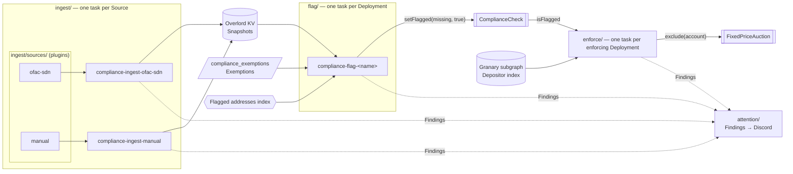

# Compliance: flagging and enforcement

The **Bot** is an Overlord signer that the **Admin** made a **Flagger** on `ComplianceCheck`. These tasks keep each **Deployment**'s Flagged addresses in line with its **Target set**: what the **Sources** (OFAC SDN and a Manual source) list, minus **Exemptions**. For Deployments with a Depositor index, **enforce** also excludes every Flagged **Depositor** from Granary **Auctions** while their **Exclusion window** is open. The Bot only ever adds flags and exclusions. Anything that needs a human becomes a **Finding**.

Terms in bold are defined in [GLOSSARY.md](./GLOSSARY.md). This README uses them in that sense only. The design reference is [SPEC.md](./SPEC.md). **Every state machine** in this module (four of them, two persisted) is listed in [SPEC.md § State machines](./SPEC.md#state-machines), with the one place each is implemented. Read that before adding a condition on any state.

## Status

Prototype. The interfaces, state machines, flagging and attention model are in place and tested. Enforce excludes Flagged Depositors and raises its Findings (`ExclusionFailed`, `MissedExclusion`, `ReinstateAvailable`, `AuctionComplianceCheckUnenforced`, `DepositorIndexLagging`). A daily flagger check per Deployment raises `BotNotFlagger` while the Bot isn't a Flagger on its ComplianceCheck. The OFAC Source reads SDN.XML, and the Flagged addresses index is the Bot's own scan of `FlaggedSet` logs. One Deployment is registered, `sepolia` (flagging and enforcing), and `main.ts` runs its tasks. It acts once the Admin makes the Bot (`compliance_flagger_signer`) a Flagger; until then, the flagger check raises `BotNotFlagger`.

> **⚠️ Known limit:** the Flagged addresses index can silently lose a `FlaggedSet` log when a lagging RPC node answers `eth_getLogs`, so an `UnbackedFlag` can go missing for good. Flagging and enforcement are unaffected. See [SPEC § Flagged addresses index](./SPEC.md#flagged-addresses-index).

## The invariant

A Deployment is in sync when exactly its Target set is Flagged:

```
Listed           Snapshot(ofac-sdn) + Snapshot(manual) + ...
Target set       Listed - Exempt
In sync when     Flagged == Target set
The Bot flags    Target set - Flagged
A human decides  Flagged - Target set   (one UnbackedFlag or ExemptFlag each)
```

Each direction has provenance, so "why is X flagged?" and "why isn't X flagged?" both have an answer that a human or a publisher wrote down:

| Deviation                            | Who fixes it | How                                                                                        |
| ------------------------------------ | ------------ | ------------------------------------------------------------------------------------------ |
| In the Target set, not Flagged       | the Bot      | `setFlagged(batch, true)` on the next run                                                  |
| Flagged, listed by no Source         | a human      | `UnbackedFlag` finding: back it by adding it to a Manual source, or the Admin unflags      |
| Flagged and Exempt                   | a human      | `ExemptFlag` finding: the Admin unflags, or remove the Exemption                           |
| Flagged by the Admin outside the Bot | a human      | the same `UnbackedFlag`, unless a Source already lists it                                  |
| Unflagged by the Admin, still Listed | the Bot      | the Bot flags it again, and its Notice says so. To unflag for good, add an Exemption first |

## Bird's-eye view



Data moves one way: **Sources → ingest → Snapshots → flag → chain → enforce**. Only `attention/` takes input from every task. Ingest never touches the chain. Flag reads Snapshots, never a Source. Enforcement sees only the chain and the Depositor index.

How each part works is in SPEC: [the ingest run](./SPEC.md#ingest-run) and [the Source machine](./SPEC.md#1-source), [Findings](./SPEC.md#findings) and [their lifecycle](./SPEC.md#2-finding), [the flag run](./SPEC.md#flag-run), [the Flagged addresses index](./SPEC.md#flagged-addresses-index) and [the enforce run](./SPEC.md#enforce-run).

## Rules

1. **Add-only.** The Flagger role allows unflagging and reinstating, but the Bot does neither: every call is `setFlagged(batch, true)` or `exclude(account)`. A Source shrinking or a new Exemption never unflags anyone. They raise `UnbackedFlag` or `ExemptFlag`, and the Admin decides. An excluded account that is no longer Flagged raises `ReinstateAvailable`, and a human decides.
2. **Absent is unknown, never empty.** A Source that has never produced a Snapshot is Absent, not `[]`. A Failing or Rejected Source keeps its last Snapshot.
3. **Stateless reconcile.** The flag task keeps no record of what it sent. It recomputes the Target set, reads `isFlagged` at head, and sends what's missing. A dropped or failed transaction is retried by the next run, and `setFlagged(true)` is idempotent.
4. **Every message is a Finding or a Notice.** A Finding needs a human; it opens and resolves. A Notice records that something happened (a Snapshot changed, the Bot flagged a batch or excluded an account) and needs nobody.
5. **The Flagged addresses index affects Findings only.** It never affects transactions.

## Admin playbook

For the Admin (the msig signers) and whoever operates the Overlord tasks.

### Levers

**Overlord variables** change what the Bot does, with no deploy. They're read on every run.

| Variable                   | What it does                                                                                                                                                                                                                                                                             |
| -------------------------- | ---------------------------------------------------------------------------------------------------------------------------------------------------------------------------------------------------------------------------------------------------------------------------------------- |
| `compliance_manual_source` | Addresses to flag that OFAC doesn't list. JSON object, address → reason: `{"0xabc…": "why it must be flagged"}`. Every entry needs a reason: one bad entry rejects the whole list (`SourceRejected`), and the last good list keeps standing until it's fixed. Shared by every Deployment |
| `compliance_exemptions`    | Addresses never to flag, even when a Source lists them. Same format: `{"0xabc…": "why it must not be flagged"}`. A bad address exempts nothing; a missing reason still exempts. Both raise `ExemptionInvalid`. A value that isn't a JSON object stops every flag run until it's fixed    |

The tuning variables (`compliance_max_flag_batch`, `compliance_max_depositor_index_lag_blocks`, `compliance_finding_reminder_secs`) are in [Configuration](#configuration).

**On-chain calls** are the Admin's own: unflagging (`setFlagged([account], false)` on the ComplianceCheck), `reinstate`, `settleEarly`, `cancel`, `setComplianceCheck`, and granting the Bot the Flagger role. The Bot never unflags or reinstates, so these are the only way to undo anything.

**Code** (`config.ts`, then a deploy): which Sources a Deployment uses, whether it enforces, private submission, and adding a Deployment.

### What you'll see

- **Findings** post to the defcon3 Discord thread, with the TSY ops tag. An opened Finding includes what to do, sends a reminder every 15 minutes while it stays open (`MissedExclusion` daily), and posts once more when it resolves. Every kind and its action is listed in [SPEC § Findings](./SPEC.md#findings).
- **Notices** (the Bot flagged a batch, excluded an account, or a Source's list changed) post to defcon5. Nobody needs to act.
- **Task failures** post to `error_webhook_url`, with links to the task and its Grafana logs. A failing task fails on every run until it's fixed, and its Findings stay as they were.

The Bot acts within about two minutes of a variable change: the Source's ingest task picks it up within a minute, and the flag task acts on it in the minute after. Exclusions happen within 20 minutes of a flag.

### Common tasks

- **Flag an address OFAC doesn't list:** add it to `compliance_manual_source` with a reason. The Bot flags it, and enforce excludes it from any Auction in its Exclusion window.
- **Unflag an address for good:** add it to `compliance_exemptions` first, then unflag it on chain. In the other order, the Bot flags it again on the next run if a Source still lists it (its Notice says so).
- **Remove a Manual source entry:** delete it from `compliance_manual_source`. The address stays Flagged, because the Bot never unflags, and `UnbackedFlag` asks you to decide. Either unflag it on chain or back it again.
- **Flag by hand on chain:** also add it to `compliance_manual_source`, so the flag has a recorded reason. Otherwise it raises `UnbackedFlag`.
- **Reinstate an excluded account** that is no longer Flagged: `ReinstateAvailable` asks for it. You can call `reinstate` only while the Auction is in Deposit; after that the account can withdraw its excluded balance.
- **Before `settleEarly`:** search the Deployment's enforce logs for `settleEarly <auction>`. Go ahead only if the latest line is less than 20 minutes old and reads `safe as of block …`, and check again just before the msig executes. See [SPEC § When the Exclusion window closes](./SPEC.md#when-the-exclusion-window-closes).
- **`BotNotFlagger`:** the Bot can't flag or exclude anything until the Admin calls `setFlagger(<Bot address>, true)` on the ComplianceCheck.

## How to read this module

Top to bottom. Each area (`ingest/`, `flag/`, `enforce/`, `flagger-check/`) has the same shape: `run.ts` is the seam (its context, config and result types, and the one function the tests call), `state.ts` or `plan.ts` holds its pure steps, and `task.ts` builds the production context and formats its Notices. In every file, types come first, then the main exports, then private helpers and constants.

Each folder's `index.ts` is its interface: what the rest of the module uses from it, and nothing more. Code in one folder imports another folder through its `index.ts`, never a file inside it. Files import their own folder's siblings directly, and a test imports the file it tests.

| Layer                | Files                                                                                                                                                                                                                                                                                           | What it gives you                                                                                                                                            |
| -------------------- | ----------------------------------------------------------------------------------------------------------------------------------------------------------------------------------------------------------------------------------------------------------------------------------------------- | ------------------------------------------------------------------------------------------------------------------------------------------------------------ |
| 1. Big ideas         | this README, [GLOSSARY.md](./GLOSSARY.md) (skim), [SPEC.md § State machines](./SPEC.md#state-machines)                                                                                                                                                                                          | The invariant, the vocabulary, every state and where it lives                                                                                                |
| 2. Interfaces        | `tasks.ts`, `config.ts`, `attention/findings.ts`, `ingest/sources/types.ts`                                                                                                                                                                                                                     | What runs and when, what a Deployment is, everything that can need a human, what a Source is                                                                 |
| 3. Seams, with tests | `ingest/run.ts` + `run.test.ts`, `flag/run.ts` + `run.test.ts`, `enforce/run.ts` + `run.test.ts`, `flagger-check/run.ts` + `run.test.ts`                                                                                                                                                        | One whole run per area, as a function of an injected context. The tests are the spec                                                                         |
| 4. Implementations   | ingest: `state.ts`, `sources/*`. flag: `plan.ts`, `flagged-addresses-index.ts`. enforce: `plan.ts`. shared: `shared/address.ts`, `shared/curated-list.ts`                                                                                                                                       | The Source and Depositor machines, the Target set and the flag rules, the Sources, the Flagged addresses index scan, addresses, the hand-curated list format |
| 5. Production wiring | `ingest/task.ts`, `flag/task.ts`, `enforce/task.ts`, `flagger-check/task.ts`, `ingest/store.ts`, `flag/flagged-addresses-index-store.ts`, `enforce/depositor-index.ts`, `attention/run.ts`, `shared/compliance-check.ts`, `shared/sender.ts`, `shared/text.ts`, `variables.ts`, `../../main.ts` | KV, viem, the Granary subgraph, Overlord variables and Discord: the adapters                                                                                 |
| 6. End to end        | `../../main-localtest/compliance.ts`                                                                                                                                                                                                                                                            | The production tasks against a Sepolia fork (see [below](#end-to-end-test-on-a-sepolia-fork))                                                                |

**Addresses.** Internally, every address is lower case and typed `LCAddress` (`shared/address.ts`). `lcAddress()` converts at each boundary where outside data enters: a Source's fetch result (`checkFetch`), a hand-curated list, `FlaggedSet` logs, the Granary subgraph, and config addresses compared with any of these.

## Persistent state

Three kinds of state are persisted in Overlord KV, each with one writer.

| KV key                                                           | Writer                   | Holds                                                                         |
| ---------------------------------------------------------------- | ------------------------ | ----------------------------------------------------------------------------- |
| `compliance/source/<id>`                                         | `compliance-ingest-<id>` | `SourceState`: the status and the Snapshot                                    |
| `compliance/findings/<owner>`                                    | the owner's task         | Open Findings for that owner                                                  |
| `compliance/flagged-addresses-index/<chainId>/<complianceCheck>` | `compliance-flag-<name>` | The Flagged addresses index: the Flagged and unflagged sets and the Watermark |

Overlord skips a run while the previous run of the same task is in progress, so no key has two concurrent writers. The flag task reads the Source keys and writes only its own Findings and Flagged addresses index keys. Enforce and the flagger check write only their Findings.

## Configuration

**Per Deployment (code, `config.ts`):** `name`, `chain`, `complianceCheck`, `signerId`, `sourceIds`, `privateSubmission`, `submissionParams`, `flaggedAddressesIndex` (`deployBlock`, `confirmations`) and, optionally, `depositorIndex` (the Granary subgraph URL and the FixedPriceAuction factory). Setting `depositorIndex` registers `compliance-enforce-<name>`. The name is the Deployment's identity: the network for its first ComplianceCheck (`mainnet`), then a suffix (`mainnet-2`). Each ComplianceCheck is its own Deployment, so moving Auctions to a new ComplianceCheck means adding one and keeping the old one until no Auction points at it; `AuctionComplianceCheckUnenforced` catches an Auction whose ComplianceCheck no Deployment enforces. `complianceTasks` refuses a duplicate name, or the same ComplianceCheck twice on one chain.

**Overlord variables (shared, `variables.ts`):**

| Variable                                    | Purpose                                                                                                    |
| ------------------------------------------- | ---------------------------------------------------------------------------------------------------------- |
| `compliance_manual_source`                  | The Manual source: JSON object of address → reason                                                         |
| `compliance_exemptions`                     | Exemptions: JSON object of address → reason                                                                |
| `compliance_max_flag_batch`                 | Most addresses per `setFlagged`, at most 500 (EIP-7825 per-transaction gas cap)                            |
| `compliance_max_depositor_index_lag_blocks` | `DepositorIndexLagging` threshold                                                                          |
| `compliance_finding_reminder_secs`          | Default reminder period, 900 (15 minutes), for open Findings whose kind uses `'default'`. 0 disables those |

Plus `mev_protected_provider_url_<chainId>` when `privateSubmission` is on: the flag task then sends through `getMevProtectedWalletClient`.

## Adding a Source

1. In `ingest/sources/<id>.ts`, implement `ComplianceSource`: `id`, `description`, `limits`, `versioned`, `fetch()`, and `latestVersion()` when `versioned`.
2. Register it in `SOURCES` (`ingest/sources/index.ts`). Its key becomes a `SourceId`.
3. Add its id to the `sourceIds` of the Deployments that should use it.

Its ingest task (`compliance-ingest-<id>`), KV key, state machine and Findings come with it. Another Manual source, one per reason, works the same way: a new variable and a new entry in `SOURCES`.

## Checks

```sh
yarn tsc --noEmit
yarn test --run src/tasks/compliance
```

## End-to-end test on a Sepolia fork

`src/main-localtest/compliance.ts` runs the production tasks against an anvil fork of Sepolia, as webhooks. Anvil's first account is the Bot, and `compliance-grant-flagger` makes it a Flagger by impersonating the ComplianceCheck's executor. KV is saved to disk, one file per key (URI-encoded, because Overlord's on-disk store refuses `/` and `:`), so every Snapshot, Finding and the Flagged addresses index can be read with `cat`. Ingest each Source before flagging: the flag task reads only stored Snapshots, never `COMPLIANCE_MANUAL_SOURCE`, so a Source that hasn't run flags nothing.

```sh
anvil --fork-url $SEPOLIA_RPC_URL
COMPLIANCE_MANUAL_SOURCE='{"0x…": "why"}' yarn dev:local:compliance
curl -X POST http://localhost:8111/webhooks/compliance-grant-flagger
curl -X POST http://localhost:8111/webhooks/compliance-ingest-ofac-sdn
curl -X POST http://localhost:8111/webhooks/compliance-ingest-manual
curl -X POST http://localhost:8111/webhooks/compliance-flag-sepolia
ls localtest-kv/compliance
```

The file header lists every webhook (the Admin flagging and unflagging by hand, mining past the Flagged addresses index's confirmations) and the environment variables. Without `COMPLIANCE_DISCORD_WEBHOOK`, a run that has a Notice or Finding to post logs it, then fails. The live Sepolia Auctions have all closed, so enforce can reach `MissedExclusion` but not an exclusion; that needs an Auction in Deposit on Sepolia.
