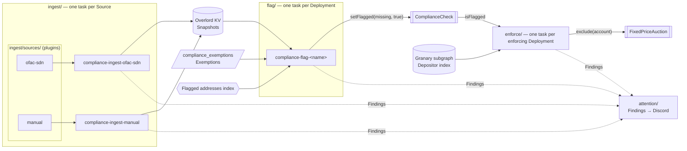
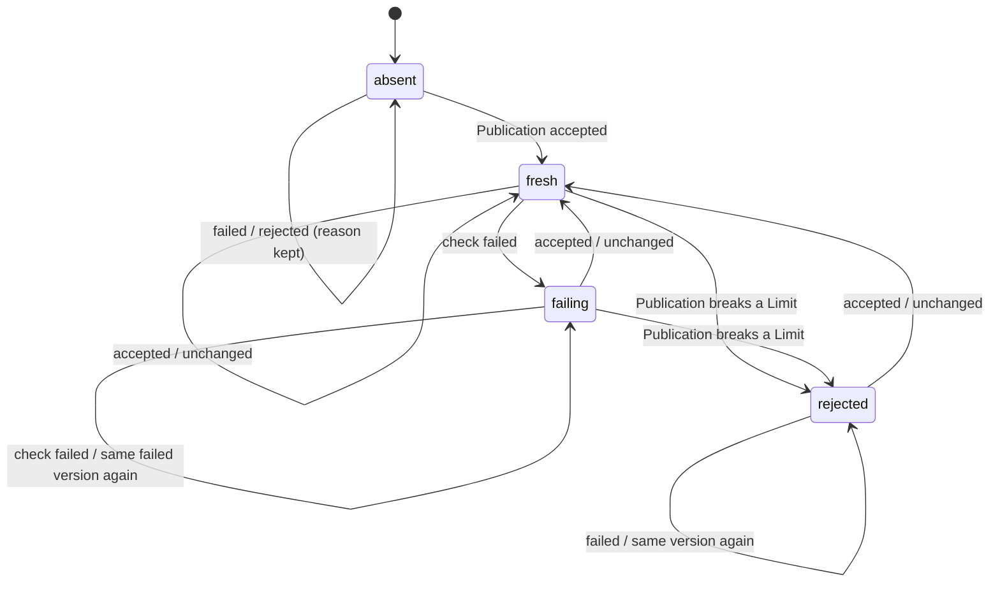

# Compliance: flagging and enforcement

Temple's ComplianceCheck contract decides which addresses are blocked from the protocol. Keeping it in line with the sanction lists by hand is slow (a newly sanctioned address can stay unflagged for days) and leaves no record of why an address is Flagged. A flag alone also doesn't keep a Flagged account's money out of a Granary **Auction**: its deposit stays in the fill unless someone excludes it inside the Auction's **Exclusion window**.

These tasks do both. The **Bot**, an Overlord signer that the **Admin** made a **Flagger** on `ComplianceCheck`, keeps each **Deployment**'s Flagged addresses in line with its **Target set**: what the **Sources** (OFAC SDN and a **Manual source**) list, minus **Exemptions**. For Deployments with a Depositor index, **enforce** also excludes every Flagged **Depositor** from Auctions while their Exclusion window is open. The Bot only ever adds flags and exclusions. Anything that needs a human becomes a **Finding**.

Terms in bold are defined in [GLOSSARY.md](./GLOSSARY.md), and this README uses them in that sense only.

**Contents:** [Status](#status) · [How it works](#how-it-works) · [Admin playbook](#admin-playbook) · [State machines](#state-machines) · [Runs](#runs) · [Developer reference](#developer-reference) · [Decisions and limits](#decisions-and-limits)

## Status

Prototype. Flagging, enforcement, the flagger check and the attention model are in place and tested. One Deployment is registered, `sepolia` (flagging and enforcing), and `main.ts` runs its tasks. It acts once the Admin makes the Bot (`compliance_flagger_signer`) a Flagger; until then, the flagger check raises `BotNotFlagger`.

Known limits are listed in [Decisions and limits](#known-limits). The one most worth knowing: the Flagged addresses index can silently lose a `FlaggedSet` log when a lagging RPC node answers `eth_getLogs`, so an `UnbackedFlag` can go missing for good. Flagging and enforcement are unaffected.

## How it works

A Deployment is in sync when exactly its Target set is Flagged:

```
Listed           Snapshot(ofac-sdn) + Snapshot(manual) + ...
Target set       Listed - Exempt
In sync when     Flagged == Target set
The Bot flags    Target set - Flagged
A human decides  Flagged - Target set   (one UnbackedFlag or ExemptFlag each)
The Bot excludes Flagged ∩ Depositors, while the Exclusion window is open
```

Four kinds of task do the work:

- **Ingest**, one task per Source, every minute. It turns each acceptable **Publication** into a **Snapshot**. A Publication that breaks the Source's **Limits** is rejected, and the previous Snapshot stands.
- **Flag**, one task per Deployment, every minute. It computes the Target set, reads `isFlagged` at chain head, and flags whatever is missing.
- **Enforce**, one task per Deployment with a Depositor index, every 2 minutes. It reads Depositors from the Granary subgraph and `isFlagged` from the chain, and excludes every Flagged Depositor in an open Exclusion window.
- **Flagger check**, one task per Deployment, daily. It raises `BotNotFlagger` while the Bot isn't a Flagger on the Deployment's ComplianceCheck, so a missing role shows before there's anything to flag.

Every hand-curated entry, in a Manual source or an Exemption, carries a written reason, so both directions have an answer that a human or a publisher wrote down:

| Deviation                            | Who fixes it | How                                                                                        |
| ------------------------------------ | ------------ | ------------------------------------------------------------------------------------------ |
| In the Target set, not Flagged       | the Bot      | `setFlagged(batch, true)` on the next run                                                  |
| Flagged, listed by no Source         | a human      | `UnbackedFlag` finding: back it by adding it to a Manual source, or the Admin unflags      |
| Flagged and Exempt                   | a human      | `ExemptFlag` finding: the Admin unflags, or remove the Exemption                           |
| Flagged by the Admin outside the Bot | a human      | the same `UnbackedFlag`, unless a Source already lists it                                  |
| Unflagged by the Admin, still Listed | the Bot      | the Bot flags it again, and its Notice says so. To unflag for good, add an Exemption first |



Data moves one way: **Sources → ingest → Snapshots → flag → chain → enforce**. Only `attention/` takes input from every task. Ingest never touches the chain. Flag reads Snapshots, never a Source. Enforce sees only the chain and the Depositor index.

### Rules

1. **Add-only.** The Flagger role allows unflagging and reinstating, but the Bot does neither: every call is `setFlagged(batch, true)` or `exclude(account)`. A Source shrinking or a new Exemption never unflags anyone. They raise `UnbackedFlag` or `ExemptFlag`, and the Admin decides. An excluded account that is no longer Flagged raises `ReinstateAvailable`, and a human decides.
2. **Absent is unknown, never empty.** A Source that has never produced a Snapshot is Absent, not `[]`. A Failing or Rejected Source keeps its last Snapshot.
3. **Stateless reconcile.** Flag and enforce keep no record of what they sent. Each run recomputes from the Snapshots and the chain at head, and sends what's missing, so a dropped or failed transaction is retried by the next run.
4. **Every message is a Finding or a Notice.** A Finding needs a human; it opens, reminds and resolves. A **Notice** records that something happened (a Snapshot changed, the Bot flagged a batch or excluded an account) and needs nobody.
5. **The Flagged addresses index affects Findings only.** It never affects transactions, so an index bug can't flag or unflag anyone.

## Admin playbook

For the Admin (the msig signers) and whoever operates the Overlord tasks.

### Levers

**Overlord variables** change what the Bot does, with no deploy. They're read on every run.

| Variable                   | What it does                                                                                                                                                                                                                                                                             |
| -------------------------- | ---------------------------------------------------------------------------------------------------------------------------------------------------------------------------------------------------------------------------------------------------------------------------------------- |
| `compliance_manual_source` | Addresses to flag that OFAC doesn't list. JSON object, address → reason: `{"0xabc…": "why it must be flagged"}`. Every entry needs a reason: one bad entry rejects the whole list (`SourceRejected`), and the last good list keeps standing until it's fixed. Shared by every Deployment |
| `compliance_exemptions`    | Addresses never to flag, even when a Source lists them. Same format: `{"0xabc…": "why it must not be flagged"}`. A bad address exempts nothing; a missing reason still exempts. Both raise `ExemptionInvalid`. A value that isn't a JSON object stops every flag run until it's fixed    |

The tuning variables are in [Configuration](#configuration).

**On-chain calls** are the Admin's own: unflagging (`setFlagged([account], false)` on the ComplianceCheck), `reinstate`, `settleEarly`, `cancel`, `setComplianceCheck`, and granting the Bot the Flagger role. The Bot never unflags or reinstates, so these are the only way to undo anything.

**Code** (`config.ts`, then a deploy): which Sources a Deployment uses, whether it enforces, private submission, and adding a Deployment.

### What you'll see

- **Findings** post to the defcon3 Discord thread, with the TSY ops tag. An opened Finding says what to do, reminds every 15 minutes while it stays open (`MissedExclusion` daily), and posts once more when it resolves. Every kind is listed in [Findings](#findings).
- **Notices** (the Bot flagged a batch, excluded an account, or a Source's list changed) post to defcon5. Nobody needs to act.
- **Task failures** post to `error_webhook_url`, with links to the task and its Grafana logs. A failing task fails on every run until it's fixed, and its Findings stay as they were.

The Bot acts within about two minutes of a variable change: the Source's ingest task picks it up within a minute, and the flag task acts on it in the minute after. Exclusions follow within a few minutes of a flag.

### Common tasks

- **Flag an address OFAC doesn't list:** add it to `compliance_manual_source` with a reason. The Bot flags it, and enforce excludes it from any Auction in its Exclusion window.
- **Unflag an address for good:** add it to `compliance_exemptions` first, then unflag it on chain. In the other order, the Bot flags it again on the next run if a Source still lists it (its Notice says so).
- **Remove a Manual source entry:** delete it from `compliance_manual_source`. The address stays Flagged, because the Bot never unflags, and `UnbackedFlag` asks you to decide: unflag it on chain, or back it again.
- **Flag by hand on chain:** also add it to `compliance_manual_source`, so the flag has a recorded reason. Otherwise it raises `UnbackedFlag`.
- **Reinstate an excluded account** that is no longer Flagged: `ReinstateAvailable` asks for it. `reinstate` works only while the Auction is in Deposit; after that the account can withdraw its excluded balance.
- **`BotNotFlagger`:** the Bot can't flag or exclude anything until the Admin calls `setFlagger(<Bot address>, true)` on the ComplianceCheck.
- **Before `settleEarly`:** see below.

#### Before settleEarly

Every enforce run logs one line per Auction in Fulfillment saying whether `settleEarly` is safe (why it works: [When the Exclusion window closes](#when-the-exclusion-window-closes)).

1. Search the Deployment's enforce logs for `settleEarly <auction>` and take the latest line. It must be from the last few minutes (enforce runs every 2): an older one means the task is failing or stopped.
2. Go ahead only if it reads `safe as of block H`. Otherwise it names what's in the way: `the Depositor index is at … before depositEnd` (wait for the index, or fix the Granary subgraph) or `N Flagged Depositor(s) still to exclude` (wait for the next run, or follow their `ExclusionFailed`).
3. Repeat step 1 just before the msig executes.

#### Troubleshooting MissedExclusion

1. Read the Auction at head: `deposits(account)` and `claimed(account)` (e.g. `cast call <auction> "deposits(address)(uint256)" <account>`).
2. If `deposits` is 0 or `claimed` is true, it's a false positive: the exclusion (or claim) landed after the Depositor index's Watermark. It resolves by itself once the index catches up. If it doesn't, check `DepositorIndexLagging` and the Granary subgraph.
3. Otherwise it's real. Compare when the account was flagged (its last `FlaggedSet` block) with the Auction's `fulfillmentEnd` (or the `settleEarly` block). Flagged after: expected, nothing could have excluded it. Flagged before: a real miss; check the enforce task's logs and any `ExclusionFailed` for that pair.
4. Either way, record it. The fill stands; the claim stays frozen while the account is Flagged. `fpa-simplified-model.md` (§ Excluding flagged bidders) lists what a missed exclusion costs and how to recover from it.

### Findings

| Kind                               | Raised by     | Key             | Human action                                                                                                                                               |
| ---------------------------------- | ------------- | --------------- | ---------------------------------------------------------------------------------------------------------------------------------------------------------- |
| `SourceUnconfirmed`                | ingest        | source          | Check the publisher or the network                                                                                                                         |
| `SourceRejected`                   | ingest        | source          | Fix the data or the Limits                                                                                                                                 |
| `SourceAbsent`                     | flag          | source          | Same as the Source's own Finding. `UnbackedFlag` checks are paused                                                                                         |
| `UnbackedFlag`                     | flag          | address         | Back it in a Manual source, or the Admin unflags it                                                                                                        |
| `ExemptFlag`                       | flag          | address         | The Admin unflags it, or remove the Exemption if it should stay Flagged                                                                                    |
| `FlaggedAddressesIndexFailing`     | flag          | —               | Fix the RPC provider (e.g. its `eth_getLogs` range cap) or the stored index. Flagging continues; `UnbackedFlag` checks are paused                          |
| `ExemptionInvalid`                 | flag          | entry           | Fix the `compliance_exemptions` entry                                                                                                                      |
| `ExclusionFailed`                  | enforce       | auction:account | Before `fulfillmentEnd`, and before any `settleEarly`: fix the cause (Flagger role, rescue mode, repointed ComplianceCheck), or the Admin excludes by hand |
| `MissedExclusion`                  | enforce       | auction:account | Follow [Troubleshooting MissedExclusion](#troubleshooting-missedexclusion), then record it                                                                 |
| `ReinstateAvailable`               | enforce       | auction:account | Reinstate before Deposit ends if appropriate, or leave it: the account can withdraw its excluded balance                                                   |
| `AuctionComplianceCheckUnenforced` | enforce       | auction         | Before `fulfillmentEnd`: add a Deployment for its ComplianceCheck (the Admin makes the Bot a Flagger there), or the Admin repoints the Auction             |
| `DepositorIndexLagging`            | enforce       | —               | Fix the Granary subgraph. Exclusions may be late                                                                                                           |
| `BotNotFlagger`                    | flagger-check | —               | The Admin grants the Bot the Flagger role (`setFlagger(bot, true)`), or confirms the removal was intended                                                  |

## State machines

Every piece of behaviour that depends on "what state is X in" is one of these machines. Each has exactly one implementation, named here: change behaviour by editing that table, not by adding conditions around it. Only machines 1 and 2 are persisted; the others are derived from scratch on every run.

| #   | Machine       | Per                | Persisted                 | Implemented in                                                                        |
| --- | ------------- | ------------------ | ------------------------- | ------------------------------------------------------------------------------------- |
| 1   | Source        | Source             | yes, by its ingest task   | ingest: `transition` (`ingest/state.ts`) inside `runIngest`                           |
| 2   | Finding       | owner × kind × key | yes, by its owner's task  | attention: `reconcileFindings` (`attention/findings.ts`)                              |
| 3   | Auction phase | Auction            | no (mirrors the contract) | `auctionPhaseAt` in `granary/auction-phase.ts`, shared with the Granary notifications |
| 4   | Depositor     | Auction × account  | no                        | enforce: `DepositorState.from` (`enforce/plan.ts`) inside `runEnforce`                |

The rest is plain rules, each also in one place: what the flag run does with an address ([Flag rules](#flag-rules), `planFlags`), how fresh the Depositor index is ([Depositor index freshness](#depositor-index-freshness)), and how an `exclude` attempt ends ([Exclude attempt](#exclude-attempt)).

### 1. Source



| Status     | Listed (what the flag run sees) | Finding (owner `ingest:<id>`)                                                                      |
| ---------- | ------------------------------- | -------------------------------------------------------------------------------------------------- |
| `absent`   | nothing: unknown, never empty   | `SourceUnconfirmed` after `unconfirmedAfterSecs`, or `SourceRejected` if the last one was rejected |
| `fresh`    | its Snapshot                    | none                                                                                               |
| `failing`  | its last Snapshot               | `SourceUnconfirmed` once the last successful check is `unconfirmedAfterSecs` old                   |
| `rejected` | its last Snapshot               | `SourceRejected`, immediately                                                                      |

- "Unconfirmed source" is a condition on `confirmedAtMs` (or `absentSinceMs` while absent), not a state. `problem` is the last failure or rejection, a string; while absent, `problemStatus` (`failing` or `rejected`) says which, and a rejection outlives a later failed check.
- `contentHash` (sha256 of the sorted `LCAddress`es) alone decides whether a Snapshot changed, and a change posts a Notice. An OFAC Publication that doesn't touch crypto addresses gives the same hash, so it posts nothing.
- A versioned Source skips a version it rejected (`rejectedVersion`, the event `stillRejected`), and for `FailedVersion.RETRY_MS` (1 h) one whose download or parse failed (`failedVersion`, the event `stillFailing`), so neither re-downloads every minute. A failed version is retried after that, in case the failure was transient.
- Limits are `minCount`, `maxDropPerPublication` and `unconfirmedAfterSecs`. A single invalid entry rejects the whole Publication. A Source reports entries it refuses itself (such as a Manual source entry without a reason) through the `invalid` list of its fetch result, and the framework treats them like invalid addresses.

### 2. Finding

```mermaid
stateDiagram-v2
  [*] --> Open: reported by a completed run (post 🔴)
  Open --> Open: reported again (silent; 🟠 reminder per its kind's policy)
  Open --> [*]: not reported by a completed run of its owner (post 🟢 resolved)
```



- Identity is `(owner, kind, key)`. Owners are `ingest:<source>`, `flag:<name>`, `enforce:<name>` and `flagger-check:<name>`, and only an owner's own task opens or resolves its Findings.
- A completed run's Findings are the whole truth for its owner, except for a kind whose check it **paused**: it couldn't tell, because of another Finding it names. Those stay open, and their reminders name the pausing Finding (`🟠 still open (check paused by FlaggedAddressesIndexFailing)`), until a run checks them again.
- A run that throws changes no Finding: nothing is reconciled or saved, the task fails, and Overlord's task exception handler posts the error to `error_webhook_url` on every failing run.
- `FINDING_KINDS` (`attention/findings.ts`) is the one place each kind declares its human action, the Discord level it posts at (opened, reminded and resolved alike, so they share a thread) and its reminder period. `'default'` uses `compliance_finding_reminder_secs` (15 minutes; 0 disables those). `MissedExclusion` reminds daily: it can't resolve while the account is Flagged.
- Every post, Finding or Notice, is logged before it is posted. A post longer than Discord's 2,000 characters is cut to fit and says how many characters it lost; the log keeps the full text. If `webhook_url` is unset, a post fails the task; for Findings that happens before anything is saved, so the next run posts again.

### 3. Auction phase

The contract's `phase()`, derived from the indexed outcome, the deadlines and the current time, never stored. Enforce and the Granary notifications use the same `auctionPhaseAt`, so they can never disagree about an Auction's phase.

```
Scheduled ─depositStart─▶ Deposit ─depositEnd─▶ Fulfillment ─fulfillmentEnd / settleEarly─▶ Settlement
     └──────────── cancel ──────────┴──────────── cancel ───┴──────────────────────────▶ Cancelled
```

Deposit and Fulfillment are the Exclusion window.

### 4. Depositor (enforce)

Derived each enforce run from the Auction's phase (machine 3), the Depositor index and `isFlagged` at head. One row applies per (Auction, account).

| Phase                                       | Flagged | Deposit > 0    | Excluded balance > 0 | State                   | Action                                                          |
| ------------------------------------------- | ------- | -------------- | -------------------- | ----------------------- | --------------------------------------------------------------- |
| Deposit, Fulfillment                        | yes     | yes            | any                  | **To exclude**          | try `exclude` ([Exclude attempt](#exclude-attempt))             |
| Deposit                                     | no      | any            | yes                  | **Reinstate available** | `ReinstateAvailable`: a human decides. The Bot never reinstates |
| Settlement                                  | yes     | yes, unclaimed | any                  | **Missed exclusion**    | `MissedExclusion`                                               |
| Cancelled, Scheduled, any other combination | —       | —              | —                    | **Clear**               | nothing                                                         |

- Only the current deposit counts. An earlier Exclusion doesn't make an account Clear: an account excluded, unflagged, re-deposited and flagged again is To exclude.
- A Cancelled Auction is always Clear. Nothing reached the proceeds; a Flagged account's frozen refund is no different from its other frozen funds.
- `ReinstateAvailable` resolves when the account is reinstated, withdraws its excluded balance, is flagged again, or Deposit ends. `MissedExclusion` resolves when the account is unflagged or claims.

## Runs

Each run is one function of an injected context, `runIngest`, `runFlag`, `runEnforce` or `runFlaggerCheck`: the context is an object of small async functions (read this, send that, the clock), and the config is plain data. The run persists nothing and posts nothing. Its task builds the production context from viem, the subgraph and Overlord, calls the run, and hands its Findings and Notices to attention; tests build the context from plain data.

### Ingest run

`runIngest(context, config)` (`ingest/run.ts`) runs one Source. The `IngestContext` holds the persisted Source state (`readState`), the Source's `latestVersion` (if it has one) and `fetch`, and the clock (`nowMs`). `config` holds the Source's id and its Limits. The run probes (`IngestEvent.probe`), fetches only when `latestVersion` doesn't match, turns the result (or the error) into exactly one event, applies `transition`, and derives the Findings with `sourceFindings`. It returns the state it started from, the event, the next state, the `SnapshotChange` (if the Snapshot's content changed) and the Findings.

`ingest/task.ts` reports the Findings, posts a Notice for a change, and only then saves the next state, so a failed post leaves the change for the next run to post again.

**Sources** are ingest's plugins (`ingest/sources/types.ts`). Each declares an id, a description, its Limits, a `fetch()`, and `versioned`: when true, it also has a cheap `latestVersion()`, which only lets ingest skip a fetch. Nothing outside ingest calls a Source.

- **OFAC SDN** uses `publicationID` as its version, so the ~30 MB `SDN.XML` downloads once per Publication. The file must match its `Record_Count` and end with `</sdnList>`, which catches a truncated download. The history request times out after a minute and the download after five.
- **Manual source** has nothing cheaper than reading its variable, so it has no `latestVersion()` and is read every run.

### Hand-curated lists

The Manual source and the Exemptions are Overlord JSON variables (`compliance_manual_source`, `compliance_exemptions`), each a JSON object mapping address → reason. `CuratedList.parse` (`shared/curated-list.ts`) reads both: unset or null is empty, anything that isn't a JSON object is `malformed`, and otherwise each entry stands alone. Its key must be an address ("not an address") and its value a non-empty string once trimmed ("no reason").

- In a Manual source, an entry without a reason, or with a bad address, rejects the whole Publication, and so does a malformed value. The previous Snapshot stands.
- In the Exemptions, an entry with a bad address exempts nothing, and an entry with a valid address but no reason still exempts it. Both raise `ExemptionInvalid`. Dropping a reasonless entry, or rejecting the whole list, would make the Bot flag exempt addresses, which can't be undone without the Admin: per-entry tolerance is the safe direction.
- A malformed `compliance_exemptions` can't be read per entry, and reading it as empty would flag every exempt address. So `runFlag` throws before any chain read, and the flag task fails on every run until a human fixes the variable.

### Flag run

`runFlag(context, config)` (`flag/run.ts`) takes a `FlagContext`: the head block, each Source's stored state (`readSources`, as its ingest task last left it, Absent if it never ran), the Exemptions, the Flagged addresses index at a block, `isFlagged` at a block, and `setFlagged(batch)`. `config` holds the batch size.

1. Read the head block once, as `atBlock`. Every chain read below is at it.
2. `TargetSet.from(sources, exemptions)`: the Target set (the union of the Deployment's Sources' Listed addresses, minus the Exempt ones), the Exempt addresses (valid entries, and entries with an address but no reason), the invalid Exemptions and the Absent Sources.
3. Scan the [Flagged addresses index](#flagged-addresses-index) up to `atBlock` minus its confirmations, then read `isFlagged` at `atBlock` for Target set ∪ Exemptions ∪ the index's Flagged addresses, in one multicall.
4. `planFlags(target, index, isFlagged)` applies the [Flag rules](#flag-rules). It returns `toFlag`, the Findings `SourceAbsent`, `ExemptionInvalid`, `ExemptFlag` and `UnbackedFlag`, and whether it could check for `UnbackedFlag`.
5. Send `setFlagged(batch, true)` in batches of at most `compliance_max_flag_batch` through Overlord's transaction manager, on the MEV-protected wallet client with `privateSubmission`. Each batch mined gives a Notice, listing as `reflagged` the addresses whose last `FlaggedSet` in the index was an unflag (the first 10, then a count), with how to unflag for good.

It returns the Findings, the Notices, and `paused: [{ kind: 'UnbackedFlag', by }]` when it couldn't check for `UnbackedFlag` (`by` is `SourceAbsent` or `FlaggedAddressesIndexFailing`). If a `setFlagged` throws, sending stops and the run also returns `sendFailure`, the error as thrown: the task posts the Notices so far, then fails with it.

#### Flag rules

`planFlags` (`flag/plan.ts`) is the only code that decides an address's fate:

- In the Target set and not Flagged: the Bot flags it. While the Bot isn't a Flagger, `setFlagged` reverts, the task fails, and it waits.
- Exempt and Flagged: `ExemptFlag`. Exemptions are read directly, so this needs no index.
- Flagged in the index, not in the Target set, not Exempt, and still Flagged at head: `UnbackedFlag`. This check pauses while any Source is Absent ("listed by no Source" can't be told apart from "Source unknown") and while the index scan fails. While paused, open `UnbackedFlag`s stay open and none opens or resolves.
- Anything else: nothing.

### Flagged addresses index

A local copy of the ComplianceCheck's Flagged set: the contract can't enumerate it, so the Bot rebuilds it from the `FlaggedSet` logs (`scanFlaggedAddressesIndex` in `flag/flagged-addresses-index.ts`, which returns `{ flagged, unflagged, complete }`). It is used only to find flags no Source backs and to name re-flags. Every candidate is re-checked at head before it becomes an `UnbackedFlag`, so an index that is behind can make a Finding late but never wrong.

- **State:** one KV value per chain and ComplianceCheck: the Flagged set, the unflagged set (accounts whose last `FlaggedSet` was an unflag, always someone else's, since the Bot never unflags) and the Watermark. With no state, the scan starts at the Deployment's `flaggedAddressesIndex.deployBlock`.
- **Scan:** each flag run, from `watermark + 1` to `head − confirmations`, in chunks of 1,000 blocks (`eth_getLogs`), applying each chunk's logs in chain order and saving after each chunk, so the set and its Watermark always agree. Staying `confirmations` blocks behind head means an applied `FlaggedSet` can't be reorged out.
- **Backfill:** at most 100 chunks per run. A longer backfill continues next run, and meanwhile the read is not `complete`. That never holds up flagging and posts nothing: the run can miss a Finding until the backfill ends but never raise a false one.
- **Failure:** a failed scan (an `eth_getLogs` error such as a range cap, or a stored index that no longer parses) never holds up flagging. `runFlag` reads the index as empty, raises `FlaggedAddressesIndexFailing`, pauses the `UnbackedFlag` check, and flags as usual. The chunks saved before the failure stand.
- **Dependencies:** only the RPC provider the flag task already uses. The Granary subgraph doesn't index flags (`fpa-simplified-model.md`), which keeps a repointed ComplianceCheck free of subgraph releases.

### Enforce run

Task `compliance-enforce-<name>`, every 2 minutes, Finding owner `enforce:<name>`. It acts on `isFlagged` at head, whoever set the flag.

`runEnforce(context, config)` (`enforce/run.ts`) takes an `EnforceContext`:

- `readHeadBlock()`: read once and first. The `isFlagged` read is pinned to it, and the Depositor index's freshness is measured against it;
- `readDepositors()`: the Depositor index read (the Deployment's Auctions and their Positions, the factory's Auctions on other ComplianceChecks, the Watermark and its timestamp). An unreachable subgraph, or one reporting `hasIndexingErrors`, throws, which fails the task;
- `readFlags(accounts, atBlock)`: of those accounts, the ones `isFlagged` at `atBlock`. Called at most once per run, and skipped when no account's state depends on a flag;
- `exclude(auction, account)`: one attempt, which resolves with the transaction hash or rejects with the decoded revert;
- `nowSecs()`: the clock.

`config` holds `maxDepositorIndexLagBlocks` and, on one Deployment per factory, `enforcedComplianceChecks`: every ComplianceCheck some Deployment enforces on that factory's Auctions. Every enforce task on a factory reads all its Auctions, so only the first Deployment registered sets it; otherwise each would raise the same `AuctionComplianceCheckUnenforced`. The run returns its Findings, its Notices, each attempt with its outcome, and a `settleEarly` check per Auction in Fulfillment, which the task logs.

1. **Read the head block**, then **the Depositor index** (the network's Granary subgraph), all at one indexed block, its Watermark:
   - every Auction with its phase inputs (deadlines, outcome) and its ComplianceCheck. Auctions with compliance disabled are dropped: nobody can enforce them, and disabling can't be undone. Of the rest, those on the Deployment's ComplianceCheck are enforced, and the others are returned as `elsewhere`, with no Positions;
   - unclaimed Positions with a current deposit > 0 in every Auction not cancelled;
   - Positions with an excluded balance > 0 in Auctions that may still be in Deposit.
     Which Positions to read follows from each Auction's phase: `PositionRead.forPhase` maps it to the reads, and `enforce/plan.test.ts` fails if `DepositorState.from` can act on a Position that phase's reads wouldn't fetch.
2. **Read `isFlagged` at the head block** for the accounts whose state depends on it, in one multicall (`readIsFlagged` in `shared/compliance-check.ts`, shared with the flag run) of about 500 calls per `eth_call`, with `allowFailure: false`. The subgraph doesn't index flags.
3. **Classify** each (Auction, account) with machine 4 and the index's [freshness](#depositor-index-freshness): the exclusions to attempt, and the Findings `MissedExclusion`, `ReinstateAvailable` and `DepositorIndexLagging`. With `enforcedComplianceChecks`, every `elsewhere` Auction on a ComplianceCheck not in it, from Scheduled to Fulfillment, raises `AuctionComplianceCheckUnenforced`.
4. **Check `settleEarly`** for each Auction in Fulfillment ([When the Exclusion window closes](#when-the-exclusion-window-closes)).
5. **Attempt each exclusion on its own**, through Overlord's transaction manager on the public wallet client: a Flagged account can't call the Auction, so there's nothing to front-run. Each result is classified by the [Exclude attempt](#exclude-attempt) table.

Apart from dropping Auctions with compliance disabled, it reads no Auction state defensively (rescue mode, the current ComplianceCheck): gas estimation rejects anything stale for free.

#### Depositor index freshness

`DepositorIndexFreshness.from` (`enforce/plan.ts`) is `lagging` when head − Watermark is above `compliance_max_depositor_index_lag_blocks`, and `withinLag` otherwise. `lagging` raises `DepositorIndexLagging` and the run proceeds as normal: lag only delays an exclusion ([below](#when-the-depositor-index-lags)).

#### Exclude attempt

Each `exclude` is tried optimistically and caught on its own (`attemptExclude`, with `ExcludeAttempt.STALE_REVERTS`). The transaction manager estimates gas before signing, so a revert at estimation costs an RPC call, not gas.

| Result                                                     | Meaning                                                                                                                                     | Outcome                                                   |
| ---------------------------------------------------------- | ------------------------------------------------------------------------------------------------------------------------------------------- | --------------------------------------------------------- |
| mined, success                                             | excluded                                                                                                                                    | Notice                                                    |
| reverts `AccountNotFlagged`                                | unflagged since the read, or the estimating node is behind head; a real unflag resolves on the next run                                     | `ExclusionFailed`                                         |
| reverts `ExpectedNonZero`                                  | already excluded, or withdrawn since the Depositor index's Watermark                                                                        | skip silently                                             |
| reverts `InvalidPhase`                                     | the Exclusion window closed since the read                                                                                                  | skip silently; `MissedExclusion` reports it if it matters |
| reverts `InvalidAccess`                                    | the Bot isn't a Flagger on this Auction's ComplianceCheck, or the Auction is in rescue mode, or compliance was disabled after the Watermark | `ExclusionFailed`                                         |
| anything else (other revert, reverted on-chain, timed out) | unexpected                                                                                                                                  | `ExclusionFailed`                                         |

`ExclusionFailed` is keyed by (Auction, account) and resolves when a later run no longer fails on that pair. Its summary names the Auction's phase and when the window closes. In Fulfillment it is the last chance: an exclusion there can't be undone, but a missed one can't be fixed at all. The run always moves on to the next attempt.

#### What the contract allows

| Call                         | Allowed when                              | Reverts when                                                                                                                                                                                                                                                                  |
| ---------------------------- | ----------------------------------------- | ----------------------------------------------------------------------------------------------------------------------------------------------------------------------------------------------------------------------------------------------------------------------------- |
| `auction.exclude(account)`   | Deposit or Fulfillment, even while paused | the caller is neither the executor (outside rescue mode) nor an active Flagger (`InvalidAccess`), wrong phase (`InvalidPhase`), account not Flagged (`AccountNotFlagged`), no deposit (`ExpectedNonZero`)                                                                     |
| `auction.reinstate(account)` | Deposit only, even while paused           | the caller is neither the executor (outside rescue mode) nor an active Flagger (`InvalidAccess`), wrong phase (`InvalidPhase`), account still Flagged (`FlaggedAccount`), nothing excluded (`ExpectedNonZero`), the reinstated deposit would overflow the funding calculation |

- **Active Flagger:** `!inRescueMode && !complianceDisabled && complianceCheck.isFlagger(caller)` on the Auction's current ComplianceCheck.
- One account per call. Exclusions add up, so excluding again after a re-deposit is valid.
- A Flagged account can't `deposit`, `withdrawDeposit`, `claim` or `withdrawExcluded`.
- An exclusion after `depositEnd` can't be undone. Under partial funding it moves the account's share of the fill to the other bidders.

#### When the Depositor index lags

The run sees Depositors as of the Watermark `W` and flags as of head `H`. Anything between `W` and `H` that the index hasn't seen yet:

| Happens after `W`                                    | What the run does                                             | Effect                                                                                                                                                                                                                       |
| ---------------------------------------------------- | ------------------------------------------------------------- | ---------------------------------------------------------------------------------------------------------------------------------------------------------------------------------------------------------------------------- |
| A Depositor deposits                                 | Doesn't see the deposit                                       | A Flagged account can't deposit. Only an account that deposits and is then flagged, both after `W`, is excluded late: on the first run after the index catches up. If the window closes first, it becomes a Missed exclusion |
| A Depositor withdraws everything                     | Tries `exclude`                                               | Reverts `ExpectedNonZero` at estimation; skipped                                                                                                                                                                             |
| An exclusion lands (this run's or another Flagger's) | Tries `exclude` again                                         | Reverts `ExpectedNonZero`; skipped                                                                                                                                                                                           |
| `settleEarly` or `cancel`                            | Thinks the window is open                                     | Reverts `InvalidPhase`; skipped. After `settleEarly`, a Flagged Depositor shows up as a Missed exclusion once the index catches up; a cancelled Auction is Clear                                                             |
| `fulfillmentEnd` passes                              | Nothing: the phase uses the current time, not the indexed one | —                                                                                                                                                                                                                            |
| `setComplianceCheck` moves the Auction               | Still reads it as ours, tries `exclude`                       | Reverts `InvalidAccess` → `ExclusionFailed` until the index catches up                                                                                                                                                       |
| `disableComplianceCheck`                             | Still reads the Auction as enforced, tries `exclude`          | Reverts `InvalidAccess` → `ExclusionFailed` until the index catches up (then the Auction is dropped)                                                                                                                         |
| An account claims                                    | Sees it unclaimed                                             | A Flagged account can't claim, so this only affects accounts that are no longer Flagged: none of its Findings apply                                                                                                          |
| An exclusion lands, then the window closes           | Sees the deposit in Settlement                                | A false `MissedExclusion` until the index catches up (see [Troubleshooting MissedExclusion](#troubleshooting-missedexclusion))                                                                                               |
| A reorg past `W`                                     | Same as the rows above                                        | Same as the rows above                                                                                                                                                                                                       |

Lag never causes a wrong exclusion: it only delays one.

#### When the Exclusion window closes

The window closes at `fulfillmentEnd`, or earlier whenever the Admin calls `settleEarly` or `cancel`. Deposit lasts at least a day, but Fulfillment has no minimum length, so a flag that lands, or an exclusion that fails, in the last run interval before the window closes can be missed. `MissedExclusion` makes that visible.

`settleEarly` is safe at block H when no Depositor with a deposit is Flagged at H and the Depositor list is complete. The list is complete once the Depositor index's Watermark block is at or after `depositEnd`: a deposit lands only before `depositEnd`, and a Flagged account can't deposit at all. Flags are read at head, so the check needs no history: when the last flag landed, and whether an exclusion failed earlier, are already in it. A successful exclusion counts once the index has seen it.

Every enforce run makes this check for each Auction in Fulfillment (`SettleEarlyCheck.from`, `enforce/plan.ts`) and logs one line, `settleEarly <auction>: safe as of block H` or `NOT safe` with what's in the way. It is never posted: `settleEarly` is rare, and a Notice per Auction would be noise. The Admin's procedure is [Before settleEarly](#before-settleearly). This is the Bot's side of the contract's rule: `fpa-simplified-model.md` (§ Excluding flagged bidders) has the msig not call `settleEarly` while a flagged depositor remains.

### Flagger check

`runFlaggerCheck(context, config)` (`flagger-check/run.ts`), one daily task per Deployment. Its context reads the Bot's address (the Deployment's signer) and `isFlagger` on the ComplianceCheck at head. It raises `BotNotFlagger` or nothing, and posts no Notices. It checks only that role.

### Attention

`attention/` owns the Finding kinds (`FINDING_KINDS`), the Finding lifecycle and Discord delivery. Every task goes through `runTask(ctx, owner, run, noticeText)`, which is two steps:

- `runWithFindings(ctx, owner, post, body)` runs the task body with a `FindingSink`, then loads, reconciles and saves the owner's open Findings and posts what changed. A body that throws changes nothing.
- `reportRun(run, sink, post)` hands a run's Findings and paused checks to the sink and posts its Notices (at `NOTICE_LEVEL`, defcon5), then throws its send failure if it has one. A Notice that fails to post doesn't stop the others, since what it reports is already on chain: every Notice is tried, then the run fails with each error.

The task succeeds loudly only when it posted.

## Developer reference

### How to read this module

Top to bottom. Each area (`ingest/`, `flag/`, `enforce/`, `flagger-check/`) has the same shape: `run.ts` is the seam (its context, config and result types, and the one function the tests call), `state.ts` or `plan.ts` holds its pure steps, and `task.ts` builds the production context and formats its Notices.

Each folder's `index.ts` is its interface: what the rest of the module uses from it, and nothing more. Code in one folder imports another folder through its `index.ts`, never a file inside it. Files import their own folder's siblings directly, and a test imports the file it tests.

| Layer                | Files                                                                                                                                                                                                                                                                                           | What it gives you                                                                                                                                            |
| -------------------- | ----------------------------------------------------------------------------------------------------------------------------------------------------------------------------------------------------------------------------------------------------------------------------------------------- | ------------------------------------------------------------------------------------------------------------------------------------------------------------ |
| 1. Big ideas         | this README ([How it works](#how-it-works), [State machines](#state-machines)), [GLOSSARY.md](./GLOSSARY.md) (skim)                                                                                                                                                                             | The invariant, the vocabulary, every state and where it lives                                                                                                |
| 2. Interfaces        | `tasks.ts`, `config.ts`, `attention/findings.ts`, `ingest/sources/types.ts`                                                                                                                                                                                                                     | What runs and when, what a Deployment is, everything that can need a human, what a Source is                                                                 |
| 3. Seams, with tests | `ingest/run.ts` + `run.test.ts`, `flag/run.ts` + `run.test.ts`, `enforce/run.ts` + `run.test.ts`, `flagger-check/run.ts` + `run.test.ts`                                                                                                                                                        | One whole run per area, as a function of an injected context. The tests are the spec                                                                         |
| 4. Implementations   | ingest: `state.ts`, `sources/*`. flag: `plan.ts`, `flagged-addresses-index.ts`. enforce: `plan.ts`. shared: `shared/address.ts`, `shared/curated-list.ts`                                                                                                                                       | The Source and Depositor machines, the Target set and the flag rules, the Sources, the Flagged addresses index scan, addresses, the hand-curated list format |
| 5. Production wiring | `ingest/task.ts`, `flag/task.ts`, `enforce/task.ts`, `flagger-check/task.ts`, `ingest/store.ts`, `flag/flagged-addresses-index-store.ts`, `enforce/depositor-index.ts`, `attention/run.ts`, `shared/compliance-check.ts`, `shared/sender.ts`, `shared/text.ts`, `variables.ts`, `../../main.ts` | KV, viem, the Granary subgraph, Overlord variables and Discord: the adapters                                                                                 |
| 6. End to end        | `../../main-localtest/compliance.ts`                                                                                                                                                                                                                                                            | The production tasks against a Sepolia fork (see [below](#end-to-end-test-on-a-sepolia-fork))                                                                |

### Code conventions

- **One place per state.** Each state machine derives its states in exactly one place, the one its row names. Other code may map a state to a property (`PositionRead.forPhase`, `beforeWindowCloses`) with an exhaustive switch, but never derives a state itself.
- **Exhaustive switches.** A switch over a union lists every case and ends with `assertNever()`, so a new state fails the typecheck everywhere it matters.
- **Companion objects.** A type and the functions that derive or read it share its name: `export type DepositorState` and `export const DepositorState = { from, dependsOnFlag }`, never a separate `depositorState()` (see `../../../AGENTS.md`).
- **Addresses.** Every address inside the module is lower case and typed `LCAddress` (`shared/address.ts`). `lcAddress()` converts at each boundary where outside data enters: a Source's fetch result (`checkFetch`), a hand-curated list, `FlaggedSet` logs, the Granary subgraph, and config addresses compared with any of these.
- **Names carry units.** Stored, config and time fields carry their unit and GLOSSARY name: `…Ms` times, `watermark`, `maxDropPerPublication`.
- **File order.** Types first, then the main exports, then private helpers and constants.

### Persistent state

Three kinds of state are persisted in Overlord KV, each with one writer.

| KV key                                                           | Writer                   | Holds                                                                         |
| ---------------------------------------------------------------- | ------------------------ | ----------------------------------------------------------------------------- |
| `compliance/source/<id>`                                         | `compliance-ingest-<id>` | `SourceState`: the status and the Snapshot                                    |
| `compliance/findings/<owner>`                                    | the owner's task         | Open Findings for that owner                                                  |
| `compliance/flagged-addresses-index/<chainId>/<complianceCheck>` | `compliance-flag-<name>` | The Flagged addresses index: the Flagged and unflagged sets and the Watermark |

Overlord skips a run while the previous run of the same task is in progress, so no key has two concurrent writers. That is also why nothing triggers a task from another: it would add a second writer ([Decisions](#decisions)).

### Configuration

**Deployments** (code, `config.ts`): `name`, `chain`, `complianceCheck`, `signerId`, `sourceIds`, `privateSubmission`, `submissionParams`, `flaggedAddressesIndex` (`deployBlock`, `confirmations`) and, optionally, `depositorIndex` (the Granary subgraph URL and the FixedPriceAuction factory). The name is the Deployment's identity: it keys task ids and Finding owners. By convention it's the network for the first ComplianceCheck (`mainnet`), then a suffix (`mainnet-2`). `complianceTasks` (`tasks.ts`) registers the tasks and refuses a duplicate name, or the same ComplianceCheck twice on one chain.

The ComplianceCheck is fixed in config, not discovered from the Auctions: the Bot can act only where the Admin made it a Flagger, and following `setComplianceCheck` would let whoever repoints an Auction steer the Bot. To move Auctions to a new ComplianceCheck, add a Deployment for it, keep the old one until no Auction points at it, and watch for `AuctionComplianceCheckUnenforced`.

A Deployment rolls out in two config steps:

| Stage                             | Tasks                                                                        | Precondition                                                                                 |
| --------------------------------- | ---------------------------------------------------------------------------- | -------------------------------------------------------------------------------------------- |
| added to `COMPLIANCE_DEPLOYMENTS` | ingest (shared), `compliance-flag-<name>`, `compliance-flagger-check-<name>` | ComplianceCheck address in the shared address tables; the Admin has made the Bot a Flagger   |
| `depositorIndex` set              | plus `compliance-enforce-<name>`                                             | the network has a Granary subgraph; the Bot is a Flagger on the Deployment's ComplianceCheck |

Losing the Flagger role changes nothing in config: the flag task's `setFlagged` reverts at simulation and the task fails, enforce's attempts fail with `ExclusionFailed`, and the flagger check raises `BotNotFlagger`.

**Overlord variables** (shared by every Deployment, `variables.ts`):

| Variable                                    | Purpose                                                                                                    |
| ------------------------------------------- | ---------------------------------------------------------------------------------------------------------- |
| `compliance_manual_source`                  | The Manual source ([Levers](#levers), [Hand-curated lists](#hand-curated-lists))                           |
| `compliance_exemptions`                     | The Exemptions (same)                                                                                      |
| `compliance_max_flag_batch`                 | Most addresses per `setFlagged`, at most 500 (EIP-7825 per-transaction gas cap)                            |
| `compliance_max_depositor_index_lag_blocks` | `DepositorIndexLagging` threshold                                                                          |
| `compliance_finding_reminder_secs`          | Default reminder period, 900 (15 minutes), for open Findings whose kind uses `'default'`. 0 disables those |

Plus `mev_protected_provider_url_<chainId>` when `privateSubmission` is on.

### Adding a Source

1. In `ingest/sources/<id>.ts`, implement `ComplianceSource`: `id`, `description`, `limits`, `versioned`, `fetch()`, and `latestVersion()` when `versioned`.
2. Register it in `SOURCES` (`ingest/sources/index.ts`). Its key becomes a `SourceId`.
3. Add its id to the `sourceIds` of the Deployments that should use it.

Its ingest task (`compliance-ingest-<id>`), KV key, state machine and Findings come with it. Another Manual source, one per kind of reason, works the same way: a new variable and a new entry in `SOURCES`.

### Tests

```sh
yarn tsc --noEmit
yarn test --run src/tasks/compliance
```

- **No mocks.** No `vi.mock`, no spies on real modules, no module patching. A run takes a context, and the test builds it from plain data and in-memory functions.
- A good test calls one seam and asserts on what it returns: the next Source state and events, the Findings, the Notices, what was sent. Tests don't assert on KV keys, call order inside a run, or internal helpers.
- The seams are `runIngest`, `runFlag`, `runEnforce` and `runFlaggerCheck`, plus the pure state machines (`checkFetch`, `transition` and `sourceFindings` for Sources; `reconcileFindings` for Findings) and attention's `runWithFindings` and `reportRun`. Their test files are the detailed spec of each.
- Internal helpers (the Target set and flag rules, freshness, the phase function, Depositor and attempt classification) are tested only through the runs, with three exceptions: `enforce/plan.test.ts` checks `DepositorState.from` against `PositionRead.forPhase`, since no run can show a Position the read never fetched; `scanFlaggedAddressesIndex` is tested on its own; and so is `decodeExcludeRevert`, which decodes against the generated `IFixedPriceAuction` ABI merged with `CommonEventsAndErrors` (`yarn install-abis` generates both).
- The production context of each task (the subgraph query, the multicall, `submitAndWait`, Discord delivery) has no unit tests. The Sepolia fork runner exercises it.

### End-to-end test on a Sepolia fork

`src/main-localtest/compliance.ts` runs the production tasks against an anvil fork of Sepolia, as webhooks. Anvil's first account is the Bot, and `compliance-grant-flagger` makes it a Flagger by impersonating the ComplianceCheck's executor. KV is saved to disk, one file per key (URI-encoded, because Overlord's on-disk store refuses `/` and `:`), so every Snapshot, Finding and the Flagged addresses index can be read with `cat`. Ingest each Source before flagging: the flag task reads only stored Snapshots, never `COMPLIANCE_MANUAL_SOURCE`, so a Source that hasn't run flags nothing.

```sh
anvil --fork-url $SEPOLIA_RPC_URL
COMPLIANCE_MANUAL_SOURCE='{"0x…": "why"}' yarn dev:local:compliance
curl -X POST http://localhost:8111/webhooks/compliance-grant-flagger
curl -X POST http://localhost:8111/webhooks/compliance-ingest-ofac-sdn
curl -X POST http://localhost:8111/webhooks/compliance-ingest-manual
curl -X POST http://localhost:8111/webhooks/compliance-flag-sepolia
ls localtest-kv/compliance
```

The file header lists every webhook (the Admin flagging and unflagging by hand, mining past the Flagged addresses index's confirmations) and the environment variables. Without `COMPLIANCE_DISCORD_WEBHOOK`, a run that has a Notice or Finding to post logs it, then fails. The live Sepolia Auctions have all closed, so enforce can reach `MissedExclusion` but not an exclusion; that needs an Auction in Deposit on Sepolia.

## Decisions and limits

### Decisions

Each is a choice that could reasonably have gone the other way.

- **Enforce runs every 2 minutes**, not 20: Fulfillment has no minimum length, so a flag near its end must be excluded quickly. Not every minute: each run makes about 4 subgraph queries, and an `isFlagged` read whenever a Position could depend on a flag (in practice every run, once a settled Auction has unclaimed deposits).
- **Enforce isn't triggered by a flag run, and isn't merged into it.** Calling or spawning `runEnforce` from the flag task would add a second writer of the `enforce:<name>` Findings beside the scheduled run. One task doing both would let a stuck transaction in either half stall the other, worst near `fulfillmentEnd`.
- **Admin unflag, Bot re-flag.** An unflag without an Exemption is undone by the next flag run: failing closed is the point of Add-only. The `Flagged` Notice names the addresses (`reflagged`), from the index's unflagged set; an unflag within the last `confirmations` blocks isn't scanned yet, so that re-flag's Notice is a plain one. Holding the re-flag until a human acts was rejected: it would let the Flagged addresses index decide a transaction, and it fails open.
- **Paused, not resolved.** While the `UnbackedFlag` check can't run (an Absent Source, a failed index scan), its open Findings stay open, rather than resolving falsely and reopening later. The Exempt case is its own kind, `ExemptFlag`, so pausing `UnbackedFlag` doesn't hold back a check that always runs.
- **A Limit rejection compares against the last accepted Snapshot**, so a large genuine delisting blocks later Publications until the Limits change. Left as is; `SourceRejected` reports it.
- **Full OFAC downloads, not deltas.** OFAC also publishes a delta per Publication, but it's a field-level diff of its entity model: applying it would mean keeping that model in KV, and one missed delta would drift the Snapshot silently. `SDN.XML` is read rather than `SDN_ADVANCED.XML` (129 MB), which carries the same EVM addresses.
- **JSON variables for hand-curated lists.** The Overlord UI may make JSON objects awkward to edit. The required reason is worth that cost, and a better editor can come later without changing the format.
- **Logging the settleEarly check, not posting it.** `settleEarly` is rare, and almost every Auction would post a "safe" Notice that nobody reads.
- **Position fields** (from the subgraph's mappings, `TempleDAO/spice-bazaar-subgraph` branch `feat/granary-indexer`, `src/mappings/fixedPriceAuction.ts`, checked against the Sepolia subgraph v0.6.1): `totalBidAmount` is `deposits[account]` (set from each Bid and Withdraw event's `accountDeposit`, zeroed by `BidderExcluded`, increased by `BidderReinstated`, left as it was by a claim, so `hasClaimed` tells claimed Positions apart). `excludedAmount` is `excluded[account]`, the live excluded balance; `excludedWithdrawnAmount` only accumulates and isn't used. Enforce filters `totalBidAmount_gt: "0"` and `excludedAmount_gt: "0"`. No Exclusion exists on Sepolia yet, so this rests on the mapping source; the first one there confirms it. A drift would only cause an `ExpectedNonZero` skip, a transient `MissedExclusion` or a stale `ReinstateAvailable`, never a wrong exclusion.

### Known limits

- **A lagging RPC node can silently drop `FlaggedSet` logs for good.** The head (`eth_blockNumber`) and each chunk's `eth_getLogs` are separate requests, and nothing makes the same node serve both: viem's `fallback` transport moves a request to the next provider when one errors, and a single hosted URL may balance across nodes. If the node serving `eth_getLogs` is more than `confirmations` blocks behind the one that served the head, and it clamps `toBlock` to its own head instead of erroring (Erigon and several hosted providers do; recent geth errors), it returns `[]` for blocks it hasn't seen, and the scan saves the Watermark past them. A `FlaggedSet` in that gap is lost from the index: its `UnbackedFlag` is never raised, and a re-flag's Notice may not name it. Flagging and enforcement are unaffected, since they read `isFlagged` at head. The planned fix is to re-scan an overlap window (`watermark − K` to the new head) each run, which is safe because the index keeps each account's last `FlaggedSet`, applied in chain order.
- **A flag between the settleEarly check and its execution is missed.** Only a contract change could close that gap. Its cost is bounded: the fill stands, the claim stays frozen while the account is Flagged, and `MissedExclusion` records it.

### Out of scope

- Any automatic unflagging or reinstating.
- Indexing flags in the Granary subgraph. `fpa-simplified-model.md` keeps the subgraph free of flags; the Bot scans its own.
- Choosing the private relay behind `mev_protected_provider_url_<chainId>`.
- Final Finding thresholds, wording and paging policy.
