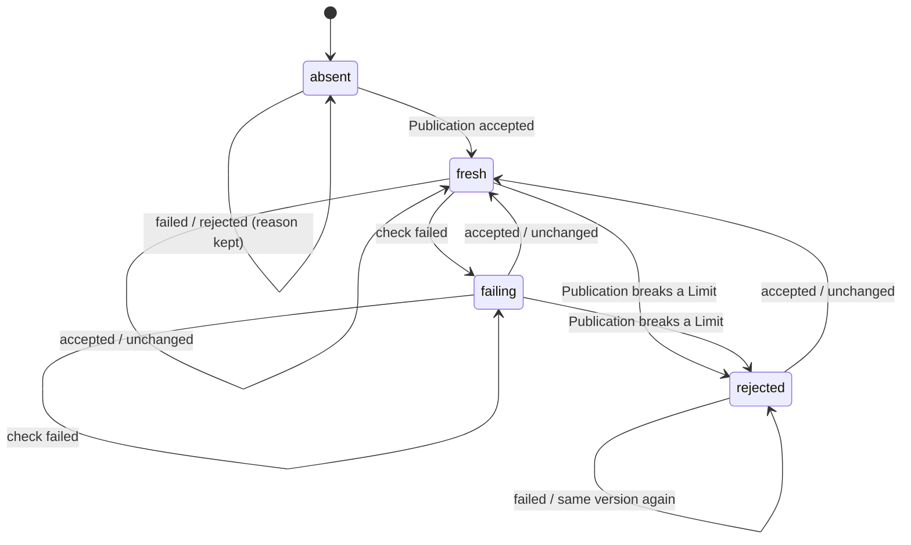

# Spec: compliance flagging and enforcement

Terms in bold are defined in [GLOSSARY.md](./GLOSSARY.md) and are used only in that sense.

## Problem Statement

Temple's ComplianceCheck contract decides which addresses are blocked from the protocol. Today a human keeps it in line with the sanction lists by hand. That is slow: a newly sanctioned address can stay unflagged for days. It is also error-prone: nobody can say why a given address is Flagged, and nobody notices when the on-chain state drifts from the lists.

The on-chain state can change from several places: the **Admin** (the multisig), any other **Flagger** it appoints, and, once it holds the Flagger role, an Overlord signer (the **Bot**). Without a single source of truth, flags set by hand become orphans that nobody can explain. A list that shrinks, or that a bad fetch truncates, could also silently undo flags if anything unflagged automatically.

A flag alone doesn't keep a Flagged account's money out of a Granary **Auction**. Its deposit stays in the fill: at settlement the bid tokens go to the treasury and the account's payout is frozen. Only an **Exclusion** takes the deposit out of the fill, and only inside the Auction's **Exclusion window**. Today nobody does that systematically.

## Solution

A set of Overlord tasks keeps every **Deployment** in sync with its **Target set**, and keeps Flagged **Depositors** out of every Auction's fill:

```
Listed           Snapshot(ofac-sdn) + Snapshot(manual) + ...
Target set       Listed - Exempt
In sync when     Flagged == Target set
The Bot flags    Target set - Flagged
A human decides  Flagged - Target set   (one UnbackedFlag each)
The Bot excludes Flagged ∩ Depositors, while the Exclusion window is open
```

- **Ingest** checks each **Source** (OFAC SDN and a **Manual source**) once a minute and turns each acceptable **Publication** into a **Snapshot**. A Publication that breaks the Source's **Limits** is rejected, and the previous Snapshot stands.
- **Flag** runs once per Deployment, every minute. It computes the Target set, reads `isFlagged` at chain head, and flags whatever is missing. It never unflags (**Add-only**).
- **Enforce** runs once per Deployment that has it enabled, every 20 minutes. It reads Depositors from the Granary subgraph and `isFlagged` from the chain, and excludes every Flagged Depositor in an open Exclusion window. It never reinstates (**Add-only**).
- **Flagger check** runs once per Deployment, daily. It reads whether the Bot holds the Flagger role on the Deployment's ComplianceCheck and raises `BotNotFlagger` while it doesn't, so a missing role shows before there is anything to flag.
- Every Flagged address must be backed by a Source. A flag that no Source explains, including one the Admin set by hand, raises an **Unbacked flag** **Finding**. A human then either backs it in a Manual source or has the Admin unflag it.
- Every hand-curated entry, whether in a Manual source or an **Exemption**, carries a written reason. Both directions therefore have an answer: "why is X Flagged?" points to a Source entry, and "why isn't X Flagged?" points to an Exemption.
- Anything that needs a human is a Finding. A Finding opens once, sends reminders while it stays open, and resolves itself when its owner no longer observes the condition. Anything a human only needs to know about is a **Notice**.

## State machines

Every piece of behaviour that depends on "what state is X in" is one of the machines below. Each has exactly one implementation: a type plus one function or table, named here. Change behaviour by editing that table, not by adding conditions around it. Switches over a machine's states are exhaustive and end with `assertNever()`.

Only machines 1 and 2 are persisted. The others are derived from scratch on every run.

| #   | Machine       | Per                | Persisted                 | Implemented in                                                                        |
| --- | ------------- | ------------------ | ------------------------- | ------------------------------------------------------------------------------------- |
| 1   | Source        | Source             | yes, by its ingest task   | ingest: `transition` (`ingest/state.ts`) inside `runIngest`                           |
| 2   | Finding       | owner × kind × key | yes, by its owner's task  | attention: `reconcileFindings` (`attention/findings.ts`)                              |
| 3   | Auction phase | Auction            | no (mirrors the contract) | `auctionPhaseAt` in `granary/auction-phase.ts`, shared with the Granary notifications |
| 4   | Depositor     | Auction × account  | no                        | enforce: `DepositorState.from` (`enforce/plan.ts`) inside `runEnforce`                |

The rest is plain rules, each also in one place: what the flag run does with an address ([Flag rules](#flag-rules), `planFlags`), how fresh the Depositor index is ([Depositor index freshness](#depositor-index-freshness)), and how an `exclude` attempt ends ([Exclude attempt](#exclude-attempt)).

### 1. Source



| Status     | Listed (what the flag run sees) | Finding (owner `ingest:<id>`)                                                                      |
| ---------- | ------------------------------- | -------------------------------------------------------------------------------------------------- |
| `absent`   | nothing: unknown, never empty   | `SourceUnconfirmed` after `unconfirmedAfterSecs`, or `SourceRejected` if the last one was rejected |
| `fresh`    | its Snapshot                    | none                                                                                               |
| `failing`  | its last Snapshot               | `SourceUnconfirmed` once the last successful check is `unconfirmedAfterSecs` old                   |
| `rejected` | its last Snapshot               | `SourceRejected`, immediately                                                                      |

A Snapshot change (content hash differs) posts a Notice. "Unconfirmed source" is a condition on `confirmedAtMs` (or `sinceMs` while absent), not a state.

### 2. Finding

```mermaid
stateDiagram-v2
  [*] --> Open: reported by a completed run (post 🔴)
  Open --> Open: reported again (silent; 🟠 reminder per its kind's policy)
  Open --> [*]: not reported by a completed run of its owner (post 🟢 resolved)
```



A completed run's Findings are the whole truth for its owner. A run that throws isn't a Finding: nothing is reconciled or saved, the task fails, and Overlord's task exception handler posts the error to `error_webhook_url` on every failing run.

### 3. Auction phase

The contract's `phase()`, derived from the indexed outcome and deadlines and the current time, never stored. The Granary notifications derive it with `auctionPhaseAt` (`granary/auction-phase.ts`). Enforce imports the same function, so the two tasks can never disagree about an Auction's phase.

```
Scheduled ─depositStart─▶ Deposit ─depositEnd─▶ Fulfillment ─fulfillmentEnd / settleEarly─▶ Settlement
     └──────────── cancel ──────────┴──────────── cancel ───┴──────────────────────────▶ Cancelled
```

Deposit and Fulfillment are the Exclusion window.

### 4. Depositor (enforce)

Derived each enforce run from the Auction's phase (machine 3), the Depositor index and `isFlagged` at head. One row applies per (Auction, account).

| Phase                                       | Flagged | Deposit > 0    | Excluded balance > 0 | State                   | Action                                                          |
| ------------------------------------------- | ------- | -------------- | -------------------- | ----------------------- | --------------------------------------------------------------- |
| Deposit, Fulfillment                        | yes     | yes            | any                  | **To exclude**          | try `exclude` ([Exclude attempt](#exclude-attempt))             |
| Deposit                                     | no      | any            | yes                  | **Reinstate available** | `ReinstateAvailable`: a human decides. The Bot never reinstates |
| Settlement                                  | yes     | yes, unclaimed | any                  | **Missed exclusion**    | `MissedExclusion`                                               |
| Cancelled, Scheduled, any other combination | —       | —              | —                    | **Clear**               | nothing                                                         |

- Only the current deposit counts. An earlier Exclusion doesn't make an account Clear: an account excluded, unflagged, re-deposited and flagged again is To exclude.
- A Cancelled Auction is always Clear. Nothing reached the proceeds; a Flagged account's frozen refund is no different from its other frozen funds.
- `ReinstateAvailable` resolves when the account is reinstated, withdraws its excluded balance, is flagged again, or Deposit ends. `MissedExclusion` resolves when the account is unflagged or claims.

### Flag rules

Each flag run reads `isFlagged` at one head block for the Target set, the Exemptions and every address the Flagged addresses index has as Flagged, in one multicall. `planFlags` (`flag/plan.ts`) then decides, and is the only code that does:

- In the Target set and not Flagged: the Bot flags it. While the Bot isn't a Flagger, `setFlagged` reverts, the task fails, and it waits.
- Exempt and Flagged: `UnbackedFlag`. Exemptions are read directly, so this needs no index.
- Flagged in the index, not in the Target set, not Exempt, and still Flagged at head: `UnbackedFlag`. This pauses while any Source is Absent (`SourceAbsent`): "listed by no Source" can't be told apart from "Source unknown".
- Anything else: nothing.

The Bot only ever adds flags. Every other change is made by a Source, an Exemption or the Admin. When the Admin unflags a Listed address, the next run flags it again: to unflag for good, add an Exemption first. The `Flagged` Notice names each address the Flagged addresses index last saw unflagged, so the round trip is visible.

### Depositor index freshness

Enforce classifies each Depositor index read with `DepositorIndexFreshness.from` (`enforce/plan.ts`), from its Watermark, the head block and `compliance_max_depositor_index_lag_blocks`: `lagging` when head − Watermark is above the threshold, `withinLag` otherwise. A read always has a Watermark; an unreachable subgraph, or one reporting `hasIndexingErrors`, throws, which fails the task. `lagging` raises `DepositorIndexLagging` and the run proceeds as normal; see [When the Depositor index lags](#when-the-depositor-index-lags).

### Exclude attempt

Each `exclude` is tried optimistically and caught on its own (`attemptExclude` in `enforce/run.ts`, with `ExcludeAttempt.STALE_REVERTS`). Overlord's transaction manager estimates gas before signing, so a revert at estimation costs an RPC call, not gas. Each attempt ends `excluded`, `skipped` or `failed`:

| Result                                                     | Meaning                                                                                                                                     | Outcome                                                   |
| ---------------------------------------------------------- | ------------------------------------------------------------------------------------------------------------------------------------------- | --------------------------------------------------------- |
| mined, success                                             | excluded                                                                                                                                    | Notice                                                    |
| reverts `AccountNotFlagged`                                | unflagged since the read, or the estimating node is behind head; a real unflag resolves on the next run                                     | `ExclusionFailed`                                         |
| reverts `ExpectedNonZero`                                  | already excluded, or withdrawn since the Depositor index's Watermark                                                                        | skip silently                                             |
| reverts `InvalidPhase`                                     | the Exclusion window closed since the read                                                                                                  | skip silently; `MissedExclusion` reports it if it matters |
| reverts `InvalidAccess`                                    | the Bot isn't a Flagger on this Auction's ComplianceCheck, or the Auction is in rescue mode, or compliance was disabled after the Watermark | `ExclusionFailed`                                         |
| anything else (other revert, reverted on-chain, timed out) | unexpected                                                                                                                                  | `ExclusionFailed`                                         |

`ExclusionFailed` is keyed by (Auction, account) and resolves when a later run no longer fails on that pair. Its summary names the Auction's phase and when the Exclusion window closes (`fulfillmentEnd`). In Fulfillment it is the last chance: an exclusion there can't be undone, but a missed one can't be fixed at all. The run always moves on to the next attempt.

## User Stories

1. As a compliance officer, I want newly sanctioned addresses flagged within minutes of OFAC publishing them, so that Temple doesn't serve sanctioned parties.
2. As a compliance officer, I want every Flagged address to trace back to a Source entry or a written reason, so that I can answer an auditor's "why is this address blocked?"
3. As a compliance officer, I want every unflagged-but-Listed address to trace back to an Exemption with a written reason, so that I can answer "why isn't this address blocked?"
4. As a compliance officer, I want to flag an address no public list names by adding it, with a reason, to a Manual source, so that hand-made decisions are recorded in the same place the Bot reads from.
5. As a compliance officer, I want a Manual source entry without a reason to be refused, so that no unexplained flag enters the system.
6. As a compliance officer, I want to exempt a Listed address with a written reason, so that a reviewed false positive is not flagged again.
7. As a compliance officer, I want a malformed Exemption entry to be reported, not to invalidate the whole Exemption list, and an entry missing only its reason still to exempt its address, so that one typo doesn't cause an exempt address to be flagged irreversibly.
8. As a compliance officer, I want a Finding when an address is Flagged but no Source lists it, so that flags the Admin set by hand don't become orphans.
9. As a compliance officer, I want a Finding when an Exempt address is still Flagged, so that I know to ask the Admin to unflag it.
10. As the Admin, I want the Bot never to unflag, so that a shrinking or truncated Publication can never release a sanctioned address without a human decision.
11. As the Admin, I want to know that unflagging a Listed address will be undone by the Bot unless I add an Exemption first, so that I unflag in the right order.
12. As the Admin, I want the flag task to fail, with its error posted on every run, while the Bot lacks the Flagger role, so that I can restore it or confirm the removal was intended.
13. As the Admin, I want a daily Finding while the Bot isn't a Flagger, so that I grant the role before there is anything to flag.
14. As an operator, I want a Publication that is suspiciously small, or that drops too many addresses at once, to be rejected while the last good Snapshot keeps standing, so that a bad upstream release doesn't reach the chain.
15. As an operator, I want a Source that has never produced a Snapshot to count as unknown and not as empty, so that a first-run failure doesn't look like "nobody is sanctioned".
16. As an operator, I want a Source that keeps failing to raise one Finding after it has gone unconfirmed for too long, and not one per failed check, so that a short outage doesn't page anyone.
17. As an operator, I want a rejected Publication to raise a Finding immediately, so that someone fixes the data or the Limits.
18. As an operator, I want the same rejected Publication not to be downloaded again every minute, so that a 30 MB OFAC file isn't fetched in a loop.
19. As an operator, I want an OFAC Publication that doesn't change any crypto address to produce no Snapshot change and no Notice, so that the channel only carries real changes.
20. As an operator, I want an Absent Source to stop no one else from flagging, so that the other Sources still protect the Deployment.
21. As an operator, I want Unbacked flag checks to pause while any Source is Absent, so that an unknown Source doesn't produce a flood of false Unbacked flags.
22. As an operator, I want a flag run to keep no record of its sends between runs, so that a dropped or failed transaction is simply retried by the next run.
23. As an operator, I want flag transactions sent in bounded batches through Overlord's transaction manager, so that gas and nonce handling are the framework's job.
24. As an operator, I want each Deployment to be able to submit through a private relay, so that flag transactions aren't front-run.
25. As an operator, I want a Notice for every batch the Bot flags and every Snapshot that changes, so that there's a record of what happened without anyone being paged.
26. As an operator, I want a task that throws to fail on every run, posted each time, and to leave its Findings as they were, so that a crash is never muted and never silently clears Findings.
27. As an operator, I want each task to resolve only its own Findings, so that a flag run can't clear an ingest problem.
28. As an operator, I want open Findings to send reminders at a configurable interval, so that an ignored problem resurfaces.
29. As an operator, I want a long Flagged addresses index backfill to continue over several runs without holding up flagging, so that a new Deployment flags from its first run.
30. As an operator, I want every Flagged addresses index candidate re-checked with `isFlagged` at head, so that an index that is behind can make a Finding late but never wrong.
31. As an operator, I want the Flagged addresses index to influence Findings and Notice text only, never transactions, so that an index bug can't flag or unflag anyone.
32. As a developer, I want to add a Source by implementing one interface and registering it, so that its ingest task, state machine, storage and Findings come for free.
33. As a developer, I want the framework, not each Source, to own versioning, content hashing and Limits, so that Sources stay small and behave the same way.
34. As a developer, I want to add another Manual source per kind of reason without new framework code, so that reasons can be grouped as the entries grow.
35. As a developer, I want to register a new Deployment by adding one config entry, so that a new network or ComplianceCheck needs no new task code.
36. As a developer, I want a whole flag run to be one function of an injected context, so that it can be tested without a chain, without a network and without mocks.
37. As a compliance officer, I want every Flagged Depositor excluded from an Auction while its Exclusion window is open, whoever set the flag, so that flagged money never reaches the treasury's proceeds.
38. As a compliance officer, I want an account that was excluded, unflagged, re-deposited and flagged again to be excluded again, so that an earlier Exclusion can't shield a new deposit.
39. As a compliance officer, I want a Finding for every Missed exclusion, so that I know when a Flagged Depositor was filled and its payout frozen.
40. As the Admin, I want the Bot never to reinstate, so that putting a deposit back into the fill is always a human decision.
41. As the Admin, I want a Finding when an excluded account is no longer Flagged while its Auction is still in Deposit, so that I can reinstate it before the chance is gone.
42. As the Admin, I want a Finding when an exclusion fails for a reason a retry won't fix (no Flagger role, rescue mode, a repointed ComplianceCheck), so that someone fixes it before the window closes.
43. As an operator, I want an exclusion to cost no gas when it would revert, so that the Bot can try optimistically instead of reading Auction state defensively.
44. As an operator, I want reverts that only mean "the index was behind" to be skipped silently, so that a lagging index doesn't page anyone.
45. As an operator, I want a Finding when the Depositor index falls too far behind the chain head, so that I know exclusions may be late.
46. As an operator, I want an enforce run to keep no record of its attempts between runs, so that a dropped exclusion is simply retried by the next run.
47. As a developer, I want enforce to derive an Auction's phase with the same function the Granary notifications use, so that the two can never disagree.
48. As a developer, I want a whole enforce run, attempts and their outcomes included, to be one function of an injected context, so that every row of the Depositor and Exclude attempt tables can be tested without a chain and without mocks.
49. As a developer, I want each task's I/O to live in one context built in one place, so that there is exactly one untested adapter per task and I know where it is.
50. As an agent working on this module, I want each state machine named with the one place it lives, so that I change behaviour by editing its table instead of adding conditions around it.

## Implementation Decisions

### Modules

- **Ingest** owns the Source state machine, the Snapshot store and one periodic task per Source. A run is one function, `runIngest(context, config)`. It never touches the chain.
- **Sources** are ingest's plugins. Each declares an id, a description, its Limits, a `fetch()`, and `versioned`: when true, it also has a cheap `latestVersion()`. Nothing outside ingest calls a Source.
- **Flag** is one function, `runFlag(context, config)`, called by one periodic task per Deployment. Its internal steps are `TargetSet.from` and `planFlags` (`flag/plan.ts`). It reads each Source's stored state (`readSources`), never the Source itself.
- **Enforce** is one function, `runEnforce(context, config)`, called by one periodic task per enforcing Deployment. Classifying Depositors (machine 4, `enforce/plan.ts`), the Depositor index's freshness and attempt outcomes are internal steps. It never reads a Source, a Snapshot, an Exemption or the Flagged addresses index.
- **Flagger check** is one function, `runFlaggerCheck(context, config)`, called by one daily task per Deployment. Its context reads the Bot's address (the Deployment's signer) and `isFlagger` on the ComplianceCheck at head. It raises `BotNotFlagger` or nothing, and posts no Notices.
- **Attention** owns the list of Finding kinds, the Finding lifecycle and Discord delivery. Every task reports to it. `runWithFindings(ctx, owner, post, body)` runs a task body with a `FindingSink`, then loads, reconciles and saves the owner's open Findings and posts what changed; a body that throws changes nothing. `reportRun(run, sink, post)` hands a run's Findings to the sink and posts its Notices, then throws its send failure if it has one. `runTask(ctx, owner, run, noticeText)` is the two together, as every task uses them: Notices go to `NOTICE_LEVEL` (defcon5), and the task succeeds loudly only when it posted.
- **Flagged addresses index** is the Bot's own scan of its ComplianceCheck's `FlaggedSet` logs, kept in KV (`scanFlaggedAddressesIndex` in `flag/flagged-addresses-index.ts`, a function of an injected `FlaggedAddressesIndexContext`; the production context, `productionFlaggedAddressesIndexContext`, is in `flag/flagged-addresses-index-store.ts`).
- **Addresses** are lower case and typed `LCAddress` inside every module (`shared/address.ts`); `lcAddress()` converts at each boundary where outside data enters.
- **Contexts.** Each run takes everything it touches as an injected context, `IngestContext`, `FlagContext`, `EnforceContext` or `FlaggerCheckContext`: an object of small async functions (read this, send that, the clock). The task builds the production context from viem, the subgraph and Overlord; tests build one from plain data. The task itself only builds the context, calls the run, and hands the run's Findings and Notices to attention.
- **Auction phase** lives in `granary/auction-phase.ts`, a module both the Granary notifications and enforce import.

Data flows one way: Sources → ingest → Snapshots → flag → chain → enforce. Only attention takes input from every task.

### Persistent state

There are three kinds of persisted state, each with a single writer, stored in Overlord KV:

- the per-Source state (status plus Snapshot), written only by that Source's ingest task;
- the per-owner open Findings, written only by the owner's task;
- the per-ComplianceCheck Flagged addresses index, written only by that Deployment's flag task (see [Flagged addresses index](#flagged-addresses-index)).

Overlord skips a run while the previous run of the same task is still going, so no key has two concurrent writers. Enforce and the flagger check add no persisted state of their own.

### Source state machine

States are `absent`, `fresh`, `failing` and `rejected`. "Unconfirmed source" is a condition (no successful check for longer than `unconfirmedAfterSecs`), not a state.

- `absent` lists nothing. The flag run treats it as unknown, never as empty.
- `failing` and `rejected` keep serving the last Snapshot.
- `rejected` raises `SourceRejected` immediately. `failing` raises `SourceUnconfirmed` only once the Source is unconfirmed.
- A rejected version is remembered so it isn't fetched again.
- `contentHash` (sha256 of the sorted `LCAddress`es) alone decides whether a Snapshot changed. A new OFAC Publication that doesn't touch crypto addresses gives the same hash, so nothing changes and no Notice is posted.
- `latestVersion()` only lets ingest skip a fetch. OFAC implements it with `publicationID`, so the ~30 MB `SDN.XML` downloads once per Publication. OFAC also publishes a delta per Publication, but it's a field-level diff of its entity model: applying it would mean keeping that model in KV, and one missed delta would drift the Snapshot silently. `SDN_ADVANCED.XML` (129 MB) carries the same EVM addresses. The Manual source has nothing cheaper than reading its config, so it doesn't implement it.

Limits are `minCount`, `maxDropPerPublication` and `unconfirmedAfterSecs`. A single invalid entry rejects the whole Publication. A Source reports entries it refuses itself (such as a Manual source entry without a reason) through an `invalid` list on its fetch result, and the framework treats them like invalid addresses.

Source contract (`ingest/sources/types.ts`):

```ts
interface SourceLimits {
  minCount: number;
  maxDropPerPublication: number;
  unconfirmedAfterSecs: number;
}
interface SourceFetch {
  /** As published. `checkFetch` turns them into `LCAddress`es. */
  addresses: readonly string[];
  version?: string;
  /** Entries the Source refused. Any entry here rejects the Publication. */
  invalid?: readonly string[];
}
```

### Ingest run

A whole ingest run for one Source is one function, `runIngest(context, config)` in `ingest/run.ts`. The `IngestContext` holds the persisted Source state (`readState`), the Source's `latestVersion` (if it has one) and `fetch`, and the clock (`nowMs`). `config` holds the Source's id and its Limits. `runIngest` probes (`IngestEvent.probe`), fetches only when `latestVersion` doesn't match, turns the result (or the error) into exactly one event, applies `transition`, and derives the Findings with `sourceFindings`. It returns the state it started from, the event, the next state, the `SnapshotChange` (if the Snapshot's content changed) and the Findings. It persists nothing. `ingest/task.ts` only builds the production context, calls `runIngest`, reports the Findings, posts a Notice for a change, and only then persists the next state, so a failed post leaves the change for the next run to post again.

### Hand-curated lists

The Manual source and the Exemptions are Overlord JSON variables (`compliance_manual_source`, `compliance_exemptions`), each a JSON object mapping address → reason. `CuratedList.parse` (`shared/curated-list.ts`) reads both: unset or null is empty, a value set to anything that isn't a JSON object is `malformed`, and otherwise each entry stands alone. Its key must be an address ("not an address") and its value a non-empty string once trimmed ("no reason"). One bad entry never rejects the others; valid entries come out as an `LCAddress` and its reason, invalid ones with their problem and, when the key is an address, that address.

- In a Manual source, an entry without a reason, or with a bad address, rejects the whole Publication, and so does a malformed value. The previous Snapshot stands.
- In the Exemptions, an entry with a bad address exempts nothing, and an entry with a valid address but no reason still exempts it. Both raise `ExemptionInvalid`. Dropping a reasonless entry, or rejecting the whole Exemption list, would make the Bot flag exempt addresses, and since the Bot never unflags, that can't be undone without the Admin. Per-entry tolerance is the safe direction.
- A malformed `compliance_exemptions` can't be read per entry, and treating it as empty would flag every exempt address. So `runFlag` throws before any chain read: the flag task fails, and its exception handler posts the error on every run until a human fixes the variable.
- There is one Manual source for now. More, one per kind of reason, are added as more Sources.

### Flag run

`runFlag(context, config)` (`flag/run.ts`) takes a `FlagContext`: the head block, each Source's stored state (`readSources`, as its ingest task last left it, Absent if it never ran), the Exemptions, the Flagged addresses index at a block, `isFlagged` at a block, and `setFlagged(batch)`. `config` holds the batch size. It returns the Findings and a Notice per batch mined. If a `setFlagged` throws, sending stops and it also returns `sendFailure`, the error as thrown: the task posts the Notices so far, then fails the run with it, so the task's exception handler reports the original error. The flag task only builds the production context, calls `runFlag`, reports the Findings and posts the Notices.

1. Read the head block once, as `atBlock`. Every chain read below is at it.
2. `TargetSet.from(sources, exemptions)`:
   - the Target set = union of the Listed addresses of the Deployment's Sources, minus the Exempt addresses;
   - the Exempt addresses (valid entries, and entries with an address but no reason), the invalid Exemptions (as `CuratedList.parse` refused them) and the Absent Sources.
3. Scan the Flagged addresses index up to `atBlock` minus its confirmations, then read `isFlagged` at `atBlock` for Target set ∪ Exemptions ∪ the index's Flagged addresses (one multicall).
4. `planFlags(target, index, isFlagged)` applies the [Flag rules](#flag-rules) and returns `toFlag` and the Findings `SourceAbsent`, `ExemptionInvalid` and `UnbackedFlag`.
5. Send `setFlagged(batch, true)` in batches of at most `compliance_max_flag_batch` through Overlord's transaction manager. With `privateSubmission`, use the MEV-protected wallet client. Return a Notice per batch, which the task posts. A Notice lists, as `reflagged`, the batch's addresses whose last `FlaggedSet` in the Flagged addresses index was an unflag (the first 10, then a count), with how to unflag for good.

### Enforce run

Task `compliance-enforce-<name>`, every 20 minutes, Finding owner `enforce:<name>`. It acts on `isFlagged` at head, whoever set the flag.

`runEnforce(context, config)` takes an `EnforceContext` with five members:

- `readHeadBlock()`: the head block, read once and first. The `isFlagged` read is pinned to it, and the Depositor index's freshness is measured against it;
- `readDepositors()`: the Depositor index read (the Deployment's Auctions and their Positions, the factory's Auctions on other ComplianceChecks, the Watermark);
- `readFlags(accounts, atBlock)`: of those accounts, the ones `isFlagged` at `atBlock`. Called at most once per run, and skipped when no account's state depends on a flag;
- `exclude(auction, account)`: one attempt, which resolves with the transaction hash or rejects with the decoded revert;
- `nowSecs()`: the clock.

`config` holds `maxDepositorIndexLagBlocks` and, on one Deployment per factory, `enforcedComplianceChecks`: every ComplianceCheck some Deployment enforces on that factory's Auctions. Every enforce task on a factory reads all its Auctions, so only the first Deployment registered sets it; otherwise each would raise the same `AuctionComplianceCheckUnenforced` under its own owner. The run returns its Findings, its Notices (data; the task formats and posts them, as the flag task does), and each attempt with its outcome (`excluded`, `skipped` or `failed`).

Built (`enforce/run.ts`, `enforce/plan.ts`, `enforce/task.ts`, `enforce/depositor-index.ts`): every row of machine 4 (To exclude, Reinstate available with `ReinstateAvailable`, Missed exclusion with `MissedExclusion`), every exclude attempt outcome (`excluded` with a Notice, `skipped` on a stale revert, silently, or `failed` with `ExclusionFailed`), and the Depositor index's freshness: `DepositorIndexLagging`, and an unreachable subgraph fails the run.

1. **Read the head block**, then **the Depositor index** (the network's Granary subgraph), all at one indexed block, its Watermark:
   - every Auction with its phase inputs (deadlines, outcome) and its ComplianceCheck;
   - unclaimed Positions with a current deposit > 0 in every Auction not cancelled (To exclude in the window, Missed exclusion once settled);
   - Positions with an excluded balance > 0 in Auctions that may still be in Deposit (Scheduled or Deposit).
     Which Positions to read follows from each Auction's phase at read time: `auctionPhaseAt` (machine 3) derives it, and `PositionRead.forPhase` maps it to the reads. `enforce/plan.test.ts` tries every phase, flag and Position shape, and fails if `DepositorState.from` can act on a Position that phase's reads wouldn't fetch. It reads every Auction of the Depositor index's factory and drops those with compliance disabled: such an Auction flags nobody and has no active Flagger, and disabling can't be undone, so nobody can enforce it. Of the rest, those whose current `complianceCheck` is the Deployment's are enforced, and the others are returned as `elsewhere`, with no Positions. `runEnforce` derives the exact phase again with its own clock, and reads `isFlagged` only for accounts whose state depends on it.
2. **Read the chain at the head block:** `isFlagged` for the accounts whose state depends on it, if there are any, against the Deployment's ComplianceCheck, in one multicall (`readIsFlagged` in `shared/compliance-check.ts`, which the flag run uses too) with an explicit `batchSize` (about 500 calls per `eth_call`, well under common `eth_call` gas caps; viem counts `batchSize` in calldata bytes, 36 per call) and `allowFailure: false`. This is the read `fpa-simplified-model.md` specifies for the dapp, too: the subgraph doesn't index flags.
3. **Classify** each (Auction, account) with machine 4 and the index's [freshness](#depositor-index-freshness). This gives the exclusions to attempt and the Findings `MissedExclusion`, `ReinstateAvailable` and `DepositorIndexLagging`. With `enforcedComplianceChecks`, every `elsewhere` Auction on a ComplianceCheck not in it, from Scheduled to Fulfillment, raises `AuctionComplianceCheckUnenforced`: nobody would exclude its Flagged Depositors.
4. **Attempt each exclusion on its own**, through Overlord's transaction manager with the Deployment's signer and `submissionParams`, on the public wallet client: a Flagged account can't call the Auction, so there is nothing to front-run. Classify each result by the [Exclude attempt](#exclude-attempt) table. Return a Notice per exclusion.

Apart from dropping Auctions with compliance disabled, it reads no Auction state defensively (rescue mode, the current ComplianceCheck): gas estimation rejects anything stale for free.

#### What the contract allows

| Call                         | Allowed when                              | Reverts when                                                                                                                                                                                                                                                                  |
| ---------------------------- | ----------------------------------------- | ----------------------------------------------------------------------------------------------------------------------------------------------------------------------------------------------------------------------------------------------------------------------------- |
| `auction.exclude(account)`   | Deposit or Fulfillment, even while paused | the caller is neither the executor (outside rescue mode) nor an active Flagger (`InvalidAccess`), wrong phase (`InvalidPhase`), account not Flagged (`AccountNotFlagged`), no deposit (`ExpectedNonZero`)                                                                     |
| `auction.reinstate(account)` | Deposit only, even while paused           | the caller is neither the executor (outside rescue mode) nor an active Flagger (`InvalidAccess`), wrong phase (`InvalidPhase`), account still Flagged (`FlaggedAccount`), nothing excluded (`ExpectedNonZero`), the reinstated deposit would overflow the funding calculation |

- **Active Flagger:** `!inRescueMode && !complianceDisabled && complianceCheck.isFlagger(caller)` on the Auction's current ComplianceCheck.
- One account per call. Exclusions add up, so excluding again after a re-deposit is valid.
- A Flagged account can't `deposit`, `withdrawDeposit`, `claim` or `withdrawExcluded`.
- An exclusion after `depositEnd` can't be undone. Under partial funding it moves the account's share of the fill to the other bidders.

#### When the Depositor index lags

The run sees Depositors as of the Watermark `W` and flags as of head `H`. Anything between `W` and `H` that the index hasn't seen yet:

| Happens after `W`                                    | What the run does                                             | Effect                                                                                                                                                                                                                       |
| ---------------------------------------------------- | ------------------------------------------------------------- | ---------------------------------------------------------------------------------------------------------------------------------------------------------------------------------------------------------------------------- |
| A Depositor deposits                                 | Doesn't see the deposit                                       | A Flagged account can't deposit. Only an account that deposits and is then flagged, both after `W`, is excluded late: on the first run after the index catches up. If the window closes first, it becomes a Missed exclusion |
| A Depositor withdraws everything                     | Tries `exclude`                                               | Reverts `ExpectedNonZero` at estimation; skipped                                                                                                                                                                             |
| An exclusion lands (this run's or another Flagger's) | Tries `exclude` again                                         | Reverts `ExpectedNonZero`; skipped                                                                                                                                                                                           |
| `settleEarly` or `cancel`                            | Thinks the window is open                                     | Reverts `InvalidPhase`; skipped. After `settleEarly`, a Flagged Depositor shows up as a Missed exclusion once the index catches up; a cancelled Auction is Clear                                                             |
| `fulfillmentEnd` passes                              | Nothing: the phase uses the current time, not the indexed one | —                                                                                                                                                                                                                            |
| `setComplianceCheck` moves the Auction               | Still reads it as ours, tries `exclude`                       | Reverts `InvalidAccess` → `ExclusionFailed` until the index catches up                                                                                                                                                       |
| `disableComplianceCheck`                             | Still reads the Auction as enforced, tries `exclude`          | Reverts `InvalidAccess` → `ExclusionFailed` until the index catches up (then the Auction is dropped)                                                                                                                         |
| An account claims                                    | Sees it unclaimed                                             | A Flagged account can't claim, so this only affects accounts that are no longer Flagged: none of its Findings apply                                                                                                          |
| An exclusion lands, then the window closes           | Sees the deposit in Settlement                                | A false `MissedExclusion` until the index catches up (see [Troubleshooting MissedExclusion](#troubleshooting-missedexclusion))                                                                                               |
| A reorg past `W`                                     | Same as the rows above                                        | Same as the rows above                                                                                                                                                                                                       |

Lag never causes a wrong exclusion: it only delays one. `DepositorIndexLagging` reports it once `head − W` passes `compliance_max_depositor_index_lag_blocks`, and the run carries on.

#### Troubleshooting MissedExclusion

1. Read the Auction at head: `deposits(account)` and `claimed(account)` (e.g. `cast call <auction> "deposits(address)(uint256)" <account>`).
2. If `deposits` is 0 or `claimed` is true, it's a false positive: the exclusion (or claim) landed after the Depositor index's Watermark. It resolves by itself once the index catches up. If it doesn't, check `DepositorIndexLagging` and the Granary subgraph.
3. Otherwise it's real. Compare when the account was flagged (its last `FlaggedSet` block) with the Auction's `fulfillmentEnd` (or the `settleEarly` block). Flagged after: expected, nothing could have excluded it. Flagged before: a real miss; check the enforce task's logs and any `ExclusionFailed` for that pair.
4. Either way, record it. The fill stands; the claim stays frozen while the account is Flagged.

#### When the Exclusion window closes

The Exclusion window closes at `fulfillmentEnd`, or earlier whenever the Admin calls `settleEarly` or `cancel`. A 20-minute cadence comfortably covers Deposit (at least a day), but Fulfillment has no minimum length. A flag that lands, or an exclusion that fails, in the last run interval before the window closes can be missed. `MissedExclusion` makes that visible. The Admin should let an enforce run pass after any new flag before calling `settleEarly`. That is the contract side of the same rule: `fpa-simplified-model.md` (§ Excluding flagged bidders) has the msig not call `settleEarly` while a flagged depositor remains, and lists what a missed exclusion costs and how to recover from it.

### Findings

- Identity is `(owner, kind, key)`. Owners are `ingest:<source>`, `flag:<name>`, `enforce:<name>` and `flagger-check:<name>`.
- A completed run resolves its own Findings that it didn't report. A run that throws changes no Finding: the task fails, and the task exception handler posts the error on every failing run.
- `FINDING_KINDS` (`attention/findings.ts`) is the one place each kind declares its human action, the Discord level it posts at (opened, reminded and resolved alike, so they share a thread) and its reminder period. A period of `'default'` uses `compliance_finding_reminder_secs` (15 minutes by default; 0 disables those reminders). `MissedExclusion` reminds daily: it can't resolve while the account is Flagged.
- Every post, Finding or Notice, is also logged. If `webhook_url` is unset, a post fails the task; for Findings that happens before anything is saved, so the next run posts again.

| Kind                               | Raised by     | Key             | Human action                                                                                                                                                        |
| ---------------------------------- | ------------- | --------------- | ------------------------------------------------------------------------------------------------------------------------------------------------------------------- |
| `SourceUnconfirmed`                | ingest        | source          | Check the publisher or the network                                                                                                                                  |
| `SourceRejected`                   | ingest        | source          | Fix the data or the Limits                                                                                                                                          |
| `SourceAbsent`                     | flag          | source          | Same as the Source's own Finding. Flagged addresses index checks are paused                                                                                         |
| `UnbackedFlag`                     | flag          | address         | Back it in a Manual source, or the Admin unflags it                                                                                                                 |
| `ExemptionInvalid`                 | flag          | entry           | Fix the `compliance_exemptions` entry                                                                                                                               |
| `ExclusionFailed`                  | enforce       | auction:account | Before `fulfillmentEnd`, and before any `settleEarly`: fix the cause (Flagger role, rescue mode, repointed ComplianceCheck), or the Admin excludes by hand          |
| `MissedExclusion`                  | enforce       | auction:account | Follow [Troubleshooting MissedExclusion](#troubleshooting-missedexclusion), then record it. The fill stands and the claim stays frozen while the account is Flagged |
| `ReinstateAvailable`               | enforce       | auction:account | Reinstate before Deposit ends if appropriate, or leave it: the account can withdraw its excluded balance                                                            |
| `AuctionComplianceCheckUnenforced` | enforce       | auction         | Before `fulfillmentEnd`: add a Deployment for its ComplianceCheck (the Admin makes the Bot a Flagger there), or the Admin repoints the Auction                      |
| `DepositorIndexLagging`            | enforce       | —               | Fix the Granary subgraph. Exclusions may be late                                                                                                                    |
| `BotNotFlagger`                    | flagger-check | —               | The Admin grants the Bot the Flagger role (`setFlagger(bot, true)`), or confirms the removal was intended                                                           |

### Flagged addresses index

A local copy of the ComplianceCheck's Flagged set: the contract can't enumerate it, so the Bot rebuilds it from the `FlaggedSet` logs. It is used only to find flags no Source backs and to name re-flags. `scanFlaggedAddressesIndex(context, config, head)` (`flag/flagged-addresses-index.ts`) scans the logs and returns `{ flagged, unflagged, complete }`. Every candidate is re-checked at head before it becomes an `UnbackedFlag`.

- **State:** one KV value per chain and ComplianceCheck, `compliance/flagged-addresses-index/<chainId>/<complianceCheck>`: the Flagged set, the unflagged set (accounts whose last `FlaggedSet` was an unflag; the Bot never unflags, so an unflag is always someone else's: the Admin or another Flagger) and `watermark`, the block it's complete to (the Watermark). With no state, the scan starts at the Deployment's `flaggedAddressesIndex.deployBlock`.
- **Scan:** each flag run, from `watermark + 1` to `head − confirmations`, in chunks of 1,000 blocks (`eth_getLogs`), applying each chunk's logs in chain order and saving after each chunk, so the set and its Watermark always agree.
- **Reorgs:** staying `confirmations` blocks behind head means a `FlaggedSet` already applied can't be reorged out. The cost is that many blocks of delay, which the head re-check makes harmless.
- **Backfill:** at most 100 chunks per run. A longer backfill continues next run, and meanwhile the read is not `complete`. That never holds up flagging, and posts nothing: the run still re-checks every candidate it has at head, so it can miss a Finding until the backfill ends but never raise a false one. Apart from the known limit below, that is the only way the index can be behind by more than its confirmations, and it is never unavailable: the scan always has a Watermark.
- **Failure:** a failed `eth_getLogs` fails the flag task; the chunks saved before it stand.
- **⚠️ Known limit: a lagging RPC node can silently drop logs for good.** The head (`eth_blockNumber`) and each chunk's `eth_getLogs` are separate requests, and nothing makes the same node serve both. viem's `fallback` transport moves a request to the next provider when the first one errors (for example a rate limit or range cap), and a single hosted URL may balance requests across nodes. If the node serving `eth_getLogs` is more than `confirmations` blocks behind the node that served the head, and it clamps `toBlock` to its own head instead of erroring (Erigon and several hosted providers do; recent geth errors), it returns `[]` for blocks it hasn't seen. The scan still saves the Watermark past them and never reads them again. A `FlaggedSet` in that gap is lost from the index: its `UnbackedFlag` is never raised, and a re-flag's Notice may not name it. Flagging and enforcement are unaffected, since they read `isFlagged` at head. Accepted for now. The planned fix is to re-scan an overlap window (`watermark − K` to the new head) each run, which is safe because the index keeps each account's last `FlaggedSet`, applied in chain order.
- **Dependencies:** only the RPC provider the flag task already uses. The Granary subgraph doesn't index flags (`fpa-simplified-model.md`), which keeps a repointed ComplianceCheck free of subgraph releases.

### Deployments

A Deployment is declared in code with its name, chain, ComplianceCheck address, signer id, Source ids, `privateSubmission`, submission params, Flagged addresses index settings (`deployBlock`, `confirmations`) and, optionally, its Depositor index (the network's Granary subgraph URL and the FixedPriceAuction factory whose Auctions it enforces). It defaults to unset. The name is the Deployment's identity: it keys task ids and Finding owners. By convention it's the network for the first ComplianceCheck (`mainnet`), then a suffix (`mainnet-2`). `complianceTasks` refuses two Deployments with one name, or with one ComplianceCheck on one chain.

The ComplianceCheck is fixed in config, not discovered from the Auctions. The Bot can act only on a ComplianceCheck whose Admin made it a Flagger, and following `setComplianceCheck` would let whoever repoints an Auction steer the Bot. Moving Auctions to a new ComplianceCheck is a runbook step: add a Deployment for it, keep the old one until no Auction points at it, and watch for `AuctionComplianceCheckUnenforced`. Which ones are registered is in [README § Status](./README.md#status).

#### Rollout

A Deployment is rolled out in two steps, both config:

| Stage                             | Tasks                                                                        | Precondition                                                                                 |
| --------------------------------- | ---------------------------------------------------------------------------- | -------------------------------------------------------------------------------------------- |
| added to `COMPLIANCE_DEPLOYMENTS` | ingest (shared), `compliance-flag-<name>`, `compliance-flagger-check-<name>` | ComplianceCheck address in the shared address tables; the Admin has made the Bot a Flagger   |
| `depositorIndex` set              | plus `compliance-enforce-<name>`                                             | the network has a Granary subgraph; the Bot is a Flagger on the Deployment's ComplianceCheck |

`complianceTasks` (`tasks.ts`) registers the tasks. The flagger check runs from the first stage: it raises `BotNotFlagger` daily until the Admin grants the Bot the Flagger role, and again whenever the role is lost. Losing the Flagger role changes nothing in config: the flag task's `setFlagged` reverts at simulation and the task fails, and enforce's attempts fail with `ExclusionFailed`.

### Code conventions

Switches over a union are exhaustive and end with `assertNever()`. Each of the four state machines above derives its states in exactly one place, the one its row names: the Auction phase only in `auctionPhaseAt`, a Depositor's state only in `DepositorState.from`. Other code may map a state to a property (`PositionRead.forPhase`, `beforeWindowCloses`) with such a switch, so adding a state fails the typecheck everywhere it matters, but never derives a state itself. A type and the functions that derive or read it share its name: `export type DepositorState` and `export const DepositorState = { from, dependsOnFlag }`, never a separate `depositorState()`. Inside the module, addresses are `LCAddress`. In every file, types come first, then the main exports, then private helpers and constants.

## Testing Decisions

- **No mocks.** No `vi.mock`, no spies on real modules, no module patching. Every dependency a unit test needs is injected: a run takes a context, and the test builds that context from plain data and in-memory functions.
- A good test calls one seam with a context and asserts on what it returns: the next Source state and events, the Findings, the Notices, what was sent (the flagged batches, the attempted exclusions and their outcomes). Tests don't assert on KV keys, call order inside a run, or internal helpers.
- Seams, highest first. There is one per task, plus the two pure state machines that are already seams:
  - **Enforce:** `runEnforce(context, config)`. A test's context is a fake chain as data: Auctions in each phase, Positions, the flagged set, the head and Watermark, and an `exclude` that records calls and resolves or rejects with a given revert. It covers every row of machine 4 and of the Exclude attempt table, the re-deposit case, Cancelled Auctions, the lag table's rows for a withdrawal, an exclusion, `settleEarly` or `cancel`, `fulfillmentEnd` passing and a claim after the Watermark, the freshness states, the skipped `isFlagged` read, and the shared phase function. An unreachable index rejects the run before any `isFlagged` read or attempt.
  - **Flag:** `runFlag(context, config)`. It carries the invariant: Target-set flagging and batching, Exemptions, Unbacked flags from Exemptions and from the Flagged addresses index, the Absent-Source pause, `ExemptionInvalid`, a malformed `compliance_exemptions` failing the run, and a Notice per batch.
  - **Flagger check:** `runFlaggerCheck(context, config)`. A test's context is the Bot's address and a ComplianceCheck's Flaggers as data. It covers a Bot that isn't a Flagger (one `BotNotFlagger` naming it) and one that is (no Findings).
  - **Ingest:** `runIngest(context, config)`. A test's context is a Source as data: its persisted state, a `latestVersion` and `fetch` that return or throw, and the clock. It covers a first good fetch, an unchanged version, a failed fetch, a Publication that breaks a Limit, and `latestVersion` throwing.
  - **Source state machine:** `checkFetch`, `transition` and `sourceFindings`. They are pure over data and need no context. They cover acceptance, Limits, rejected-version memory, unconfirmed timing, and a refused entry rejecting the whole Publication.
  - **Finding lifecycle:** `reconcileFindings`, pure over data. It covers open, reminder (per kind), resolve and owner isolation. `runWithFindings` and `reportRun` are tested beside it: a body that throws fails the task and touches no KV, a Finding that can't be posted is logged and fails the run with nothing saved, and a run's send failure is thrown after its Notices are posted.
- The Target set and flag rules, the Depositor index's freshness, the Auction phase function, and the classification of Depositors and attempt outcomes are internal helpers. They are tested only through `runFlag` and `runEnforce`, with one exception: `enforce/plan.test.ts` tests machine 4 (`DepositorState.from`) against `PositionRead.forPhase` directly, since no run can show a Position the read never fetched. The Flagged addresses index scan is tested on its own (`scanFlaggedAddressesIndex`).
- Enforce's revert decoding is tested on its own (`decodeExcludeRevert`): it decodes against the generated `IFixedPriceAuction` ABI merged with `CommonEventsAndErrors`, whose library errors (`InvalidAccess`, `ExpectedNonZero`) an interface ABI leaves out. `yarn install-abis` generates both.
- The only code without unit tests is the production context per task (the subgraph query, the multicall, `submitAndWait`, Discord delivery). The local end-to-end runner against a Sepolia fork (`main-localtest/compliance.ts`) exercises it.
- Prior art: the Granary task tests in the same app (Vitest).
- Checks: `yarn tsc --noEmit` and `yarn test --run src/tasks/compliance`.

## Out of Scope

- Applying OFAC's per-Publication delta files. The Source downloads the whole `SDN.XML` once per Publication instead.
- Indexing flags in the Granary subgraph. `fpa-simplified-model.md` keeps the subgraph free of flags; the Bot scans its own.
- Reinstating automatically.
- Running enforce on demand (a webhook or manual trigger). Overlord webhooks aren't wired up for this app.
- Choosing the private relay behind `mev_protected_provider_url_<chainId>`.
- Final Finding thresholds, wording and paging policy.
- Any automatic unflagging.

## Further Notes

- **Admin unflag, Bot re-flag.** The documented way to unflag a Listed address is an Exemption first, then the Admin unflags (`UnbackedFlag` asks for it). An unflag without an Exemption is undone by the next flag run: failing closed is the point of Add-only. The `Flagged` Notice says so and names the addresses (`reflagged`), from the Flagged addresses index's unflagged set. An unflag within the last `confirmations` blocks isn't scanned yet, so that re-flag's Notice is a plain one. Holding the re-flag until a human acts was rejected: it would let the Flagged addresses index decide a transaction, and it fails open.
- **Position fields (read from the subgraph's mappings, `TempleDAO/spice-bazaar-subgraph` branch `feat/granary-indexer`, `src/mappings/fixedPriceAuction.ts`, and checked against the Sepolia subgraph v0.6.1):** the Position mirrors the contract's per-account state. `totalBidAmount` (a token-decimal BigDecimal) is `deposits[account]`: set from each Bid and Withdraw event's `accountDeposit` (Bids of 60 and 40 and a Withdraw of 25 give `75`), zeroed by `BidderExcluded`, increased by `BidderReinstated`, and left as it was by a claim, so `hasClaimed` tells claimed Positions apart. `excludedAmount` is `excluded[account]`, the live excluded balance: increased by `BidderExcluded`, zeroed by `BidderReinstated` and `ExcludedWithdrawn`. `excludedWithdrawnAmount` only accumulates withdrawn excluded balances; enforce doesn't use it (`excludedAmount − excludedWithdrawnAmount` would be wrong). Enforce filters `totalBidAmount_gt: "0"` for a deposit and `excludedAmount_gt: "0"` for an excluded balance. No Exclusion exists on Sepolia yet, so this rests on the mapping source, not on observed data; the first Exclusion there confirms it. If the deployed subgraph ever drifted from it, a stale deposit only causes an `ExpectedNonZero` skip, or a transient `MissedExclusion` once settled, and a stale excluded balance only a stale `ReinstateAvailable`: never a wrong exclusion.
- The Overlord UI may limit how comfortably JSON objects can be edited. The required reason is worth that cost. A better editor can come later without changing the format.
- Status: see [README § Status](./README.md#status).

## Review revisions (2026-11-20)

Each line is a decision the review took, and any of them can be reverted.

- Enforce runs every 20 minutes, not 30: Fulfillment has no minimum length.
- A Limit rejection still compares against the last accepted Snapshot, so a large genuine delisting blocks later Publications until the Limits change (left as is; `SourceRejected` reports it).
- A `compliance_exemptions` entry with a valid address and no reason still exempts it and raises `ExemptionInvalid`.
- Each Finding kind declares its DEFCON level and reminder period in `FINDING_KINDS`, beside its action. Notices post at `NOTICE_LEVEL`.
- `MissedExclusion` reminds daily: it can't resolve while the account is Flagged.
- Every Finding and Notice line is logged before it is posted. A post that can't be sent (`webhook_url` unset) fails the task, and nothing is saved as posted.
- An absent Source that was rejected keeps `SourceRejected` through a failed check.
- `SDN.XML` must end with `</sdnList>`, in addition to matching `Record_Count`.
- The ingest task saves the Source state only after posting, so a failed post repeats the change Notice and never loses it.
- Stored, config and time fields carry their units and GLOSSARY names: `…Ms` times, `watermark`, `compliance_manual_source`, `compliance_max_flag_batch`, `maxDropPerPublication`.
- A daily flagger check per Deployment raises `BotNotFlagger` while the Bot isn't a Flagger on the ComplianceCheck, so a missing role shows before a `setFlagged` reverts. It checks only that role.
