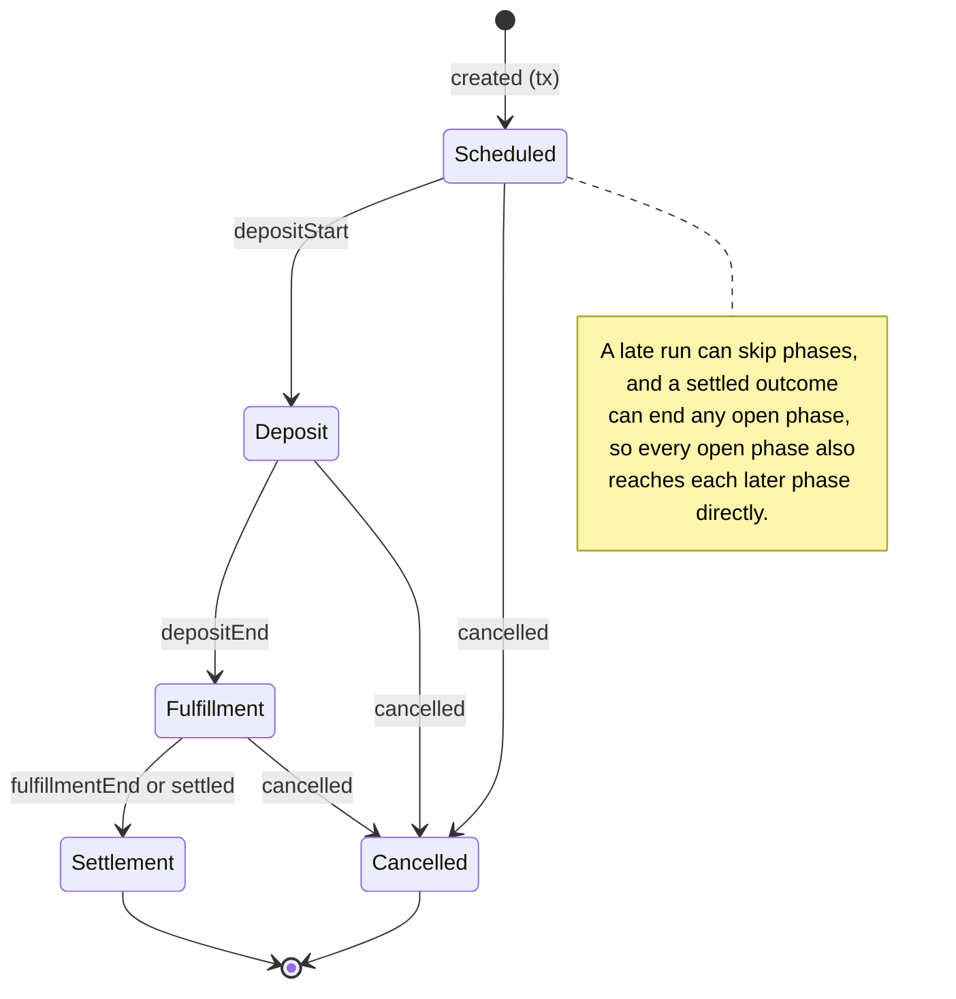

# Granary announcements

Every Granary deployment is defined once in `config.ts`: its network name, chain, subgraph URL, auction factory and Wishing Well, plus its Overlord variables. `GRANARY_DEPLOYMENTS` lists the deployments the production runner serves, currently only Sepolia; mainnet is not deployed or indexed yet. For each deployment the runner registers `granary-auction-notifications-<network>` and `granary-wish-notifications-<network>` every 20 minutes, so deployments run side by side. Each job keeps one cursor in Overlord KV, scoped by chain and contract. A deployment's jobs stay idle while its webhook is unset.

`tasks.ts` wraps the notification implementations: it reads a deployment's settings and KV cursors, creates the subgraph and token API, sends digests and saves cursors after successful delivery. `auctions.ts` and `wishes.ts` accept dependencies and return announcements (Discord embeds) with the next cursor; they do not access Overlord or Discord delivery. `shared.ts` holds the `CursorStep` type, token labels, Discord timestamps and explorer links, and embed limit checks and batching.

Set these **Overlord variables** per deployment, replacing `<network>` with its name (for example `granary_sepolia_notifications_webhook_url`), without embedding server credentials in source:

| Variable                                      | Type          | Purpose                                                                 |
| --------------------------------------------- | ------------- | ----------------------------------------------------------------------- |
| `granary_<network>_notifications_webhook_url` | Secret string | Announcements webhook, separate from operational alerts; unset disables |
| `granary_<network>_moonwatcher_role_id`       | String        | Role mentioned on auction messages; unset sends without a mention       |
| `granary_<network>_wisher_role_id`            | String        | Role mentioned on wish messages; unset sends without a mention          |
| `granary_<network>_auction_url_template`      | String        | App URL with `{id}`, `{address}` or `{epoch}` placeholders              |

The chain, subgraph and contract addresses are static facts about a deployment, so they live in `config.ts` rather than in variables. Copy contract addresses from `protocol/scripts/deploys`; Sepolia's come from `protocol/scripts/deploys/sepolia/templegold/contract-addresses/sepolia.ts`. The subgraph URL is pinned to a version that has every field the tasks read.

To add mainnet once Granary is deployed and indexed there, define `GRANARY_MAINNET` with `defineGranaryDeployment` like `GRANARY_SEPOLIA`, add it to `GRANARY_DEPLOYMENTS`, and set its `granary_mainnet_*` variables. The runner needs an RPC provider for each deployment's chain.

Use the app's canonical auction route in production. A dummy template such as `https://example.invalid/auctions/{id}` is suitable for the test server. Keep Discord role IDs as strings. Role creation and opt-in assignment belong to Discord server setup.

First execution records a silent baseline. The auction cursor stores the completed indexed block and timestamp; the wish cursor stores only the completed block. No per-auction phase or per-wish delivery records are persisted.

Auctions compare the current indexed snapshot with the historical snapshot at their cursor, using each snapshot's indexed time and outcome. This catches clock settlement without a settlement event and announces only the current phase after downtime. The endpoint must retain historical auction data back to the cursor. A missing historical snapshot fails the run without advancing it.

Each announcement is a Discord embed. An auction embed's title names the pair, then the auction number, and links to the auction page; its colour and description show the phase (🌑 New Moon, 🌒 Crescent, 🌔 Gibbous, 🌕 Full Moon, 🌘 Eclipse). Its fields show when the phase began, the fill for finished auctions ("No deposits" when nothing was deposited) and, for a newly created auction, the creation transaction. A wish embed shows the offered amount and token, the requested token, when it was cast, when it expires, and its transaction. Times use Discord timestamp markup, rendered in each reader's timezone with a relative time, because a run every 20 minutes can report an event well after it happened. Only a newly created auction links a transaction.

Each task collects its announcements into a digest of messages with up to 10 embeds and 6,000 embed characters each, which are Discord's limits. The role mention is the message text, because mentions inside embeds do not notify. When a role variable is unset or is not a Discord role ID, the task logs a warning and posts the embeds without a mention; the run still succeeds and the cursor advances. Every embed is checked against Discord's embed limits before anything is sent; titles are truncated to fit. The cursor advances once, after the entire digest succeeds. A failed run retries against the latest indexed snapshot; earlier messages can repeat if a later send failed or the process stopped before saving the cursor. This tradeoff is intentional. Readers who turned off "Show embeds and link previews" in Discord see only the mention.

Wishes use latest rows updated since their completed block; intermediate updates may disappear. Wish filtering remains a deferred decision: the task applies no token/pair allowlist.

The subgraph must index only the deployment's well: the deployed schema cannot filter wishes by a well address. Changing the chain, factory or well selects separate progress; changing only the subgraph version preserves progress and requires compatible historical auction data. Each task fails if the indexer is behind its cursor.

For missing token metadata, the wish job reads the token through the deployment chain's Overlord RPC provider and falls back to an address with labelled raw units if the read fails. Auction production runs use the subgraph without per-auction RPC calls.

## State machines

Two state machines drive the tasks. Change behaviour by editing their tables, not by adding conditions around them.

**Auction phases** — `PHASES` in `auctions.ts`. Phases are derived from the outcome and the deadlines, never stored, the same way the contract's `phase()` does. `outcome` mirrors the contract: only an early settlement (`settleEarly`) sets `Settled`, and a cancellation sets `Cancelled`. Settlement at `fulfillmentEnd` runs no transaction, so `outcome` stays `None` and the deadline decides; a later claim or `emitSettlement` sets `settledAt` to `fulfillmentEnd`. A run announces the current phase only when `PHASES[previous].next` contains it, or when the auction is new since the cursor. Terminal phases have no exits, and an unchanged or backwards move (for example after a reorg) is never announced. A late run announces only where each auction is now, not the phases it passed through. A run's announcements are ordered by when each auction entered its phase, oldest first.



**Cursor lifecycle** — `CursorStep` in `shared.ts`, applied by `advanceCursor` in `tasks.ts` for both tasks. Each collector returns one step: `baseline` (first run: save the snapshot silently), `unchanged` (indexer has not moved: do nothing) or `advanced` (send the digest, then save the cursor). An indexer behind the cursor throws and leaves the cursor in place.

## Checks

Run deterministic tests with `yarn test --run` and type-check with `yarn tsc --noEmit`.

The read-only live subgraph test runs against every deployment in `GRANARY_DEPLOYMENTS` and stays disabled unless `GRANARY_LIVE` is set. Run `GRANARY_LIVE=1 yarn test --run src/tasks/granary/subgraph.live.test.ts`. It checks current and historical auction queries and wish updated-block filtering without sending Discord messages.

Test notification delivery manually with the dedicated Sepolia runner in `src/main-localtest/granary.ts`. It needs no anvil fork. It uses `GRANARY_SEPOLIA` from `config.ts`, with a dummy auction URL template. Pass a test Discord webhook and a Sepolia RPC through the environment (required), plus test role IDs (optional; without them messages go out without a mention). The RPC is the Sepolia provider, as production always has one; block ranges also use it to read block timestamps. viem's default public Sepolia RPC rejects unpaid requests, so there is no fallback:

```sh
GRANARY_NOTIFICATIONS_WEBHOOK_URL=... GRANARY_MOONWATCHER_ROLE_ID=... \
GRANARY_WISHER_ROLE_ID=... SEPOLIA_RPC_URL=... yarn dev:local:granary
```

**Reproduce a block range.** To check what production would have announced for changes in blocks (A, B], run the production collectors with the cursor at block A and the subgraph read at block B. `from` defaults to one block before the first auction (12023503) or wish (12099644) on Sepolia, and `to` to the latest indexed block, so a call without parameters replays all activity. No KV cursor is touched, so a range can be repeated as often as needed:

```sh
curl -X POST 'http://localhost:8111/webhooks/granary-auction-range?from=A&to=B'
curl -X POST 'http://localhost:8111/webhooks/granary-wish-range?from=A&to=B'
```

A production run covers the range from its saved cursor to the block indexed when it ran. To reproduce a specific run, use those two blocks.

**Preview every announcement type.** Fake data gives one auction embed per distinct announcement (each phase, clock and event settlement, a cancellation without deposits, an unresolved token symbol) and two wishes (resolved and raw-unit amounts). It runs through the production collectors and Discord delivery:

```sh
curl -X POST http://localhost:8111/webhooks/granary-fake-auction-states
curl -X POST http://localhost:8111/webhooks/granary-fake-wishes
```

**Run the production tasks.** The local runner keeps their cursors in memory, while production persists them. The first call records a silent baseline at the latest indexed block, and each later call announces what changed since the previous one. Call again without new activity to check nothing is resent; failures leave the cursor for retry. Restart the runner to reset the cursors:

```sh
curl -X POST http://localhost:8111/webhooks/granary-auction-notifications-sepolia
curl -X POST http://localhost:8111/webhooks/granary-wish-notifications-sepolia
```
