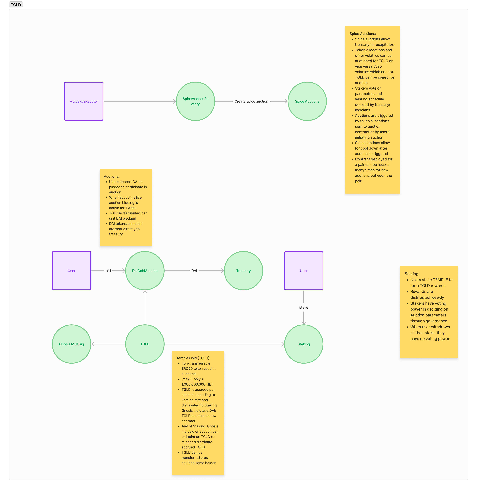

# TEMPLE GOLD (TGLD)

## Background

Temple Gold (TGLD) is non-transferrable ERC-20 token that serves as “points” that can only interact with whitelisted contracts
- Staking
- Auctions Escrow
- Team Gnosis
- Spice Bazaar Auctions Contract(s)
Which means TGLD tokens can be sent to staking and auction contracts as staking rewards and as auction rewards.
The mint source chain of Temple Gold is `Arbitrum One`. With layer zero integration, Temple Gold can be transferred cross-chain. A holder can only transfer cross-chain to their own address.


## High level design


## Temple Gold Token (TGLD)

Section here talks about technicals on Temple Gold.


### Admin

Temple Gold (TGLD) extends layer zero's `OFT` contracts, which depend on Open Zeppelin's (OZ) `Ownable`. Temple contracts are controlled with `TempleElevatedAccess`, which is a more flexible upgrade to `Ownable`. To avoid manual changes to imported Layer Zero contracts, Temple Gold is controlled by `TempleGoldAdmin` which uses `TempleElevatedAccess`

### Constants

TGLD has the below constant values. When `mint()` is called, distribution happens only when mint amount is greater than `MINIMUM_MINT`

```solidity
//// @notice Distribution as a percentage of 100
uint256 public constant DISTRIBUTION_DIVISOR = 100 ether;
/// @notice 1B max supply
uint256 public constant MAX_CIRCULATING_SUPPLY = 1_000_000_000 ether; // 1B
/// @notice Minimum Temple Gold minted per call to mint
uint256 public constant MINIMUM_MINT = 10_000 ether;
```

### Minting

Amount of tokens to mint are accrued per second depending on a vesting schedule. The vesting schedule (factor) is set using function `setVestingFactor(VestingFactor calldata _factor)`. 

```solidity
struct VestingFactor {
    /// @notice Value of vesting factor. Typically 35
    uint128 value;
    /// @notice Week multiplier. Typically 1 week
    uint128 weekMultiplier;
}

```

`mint()` is a public function when called, tokens  are distributed according to the vesting factor, if accrued tokens at current time are more than `MINIMUM_MINT`.
`distributeGold()` in TempleGoldStaking and DaiGoldAuction contracts also call `mint()`.

Minting is only done on the source chain Arbitrum One.
Minted tokens are distributed to staking, DaiGold auction contract and team gnosis depending on the set distribution parameters. Distribution parameters are set with `setDistributionParameters()` by admin.


## Staking

Templars stake Temple tokens for Temple Gold rewards.
Temple can be transferred cross-chain to Arbitrum One using the `TempleTeleporter` contract. Temple tokens are burned on mainnet and same amount of tokens are minted on arbitrum one.

Staking contract has voting capabilities built in.
When a user stakes or withdraws, their delegate's vote is updated. A staker participating in governance must set delegate to either own address or another address using `delegate()`. Setting delegate to address zero means no participation in governance(default). A user can set delegate (to self or another address) before or after staking. The plan for UI flow is to let stakers set delegate first if they want to do governance voting.

Migration is built in, if there is an upgrade to staking contract. First, `setMigrator()` is called. Migrator is the next staking contract. Migrator calls `migrateWithdraw()` to withdraw and migrate staker's stake amount and optionally claim rewards.
Rewards can be claimed after migration.

Staking contract will also be deployed to Arbitrum One chain.

Staking contract has unstake cooldown feature. This means cooldown time after staking, before staker can unstake.

## Auctions

### DaiGold Auctions
In DaiGold auctions, bidders bid DAI in exchange for Temple Gold when an auction is active. These Temple Gold tokens available for each auction are sent to `DaiGoldAuction` contract prior to auction starting. 

`TempleGold.mint()` distributes TGLD tokens on mint to DaiGoldAuction, Staking contracts and team multisig using distribution share parameters percentages set at `DistributionParams`. 
Temple Gold reward tokens for each auction are shared amongst DAI bidders/depositors after the auction has ended. DAI depositors can claim their share of the TGOLD rewards after auction and also retroactively.

A `DaiGold` auction has the following configuration options.
```solidity
    struct AuctionConfig {
        /// @notice Time diff between two auctions. Usually 2 weeks
        uint32 auctionsTimeDiff;
        /// @notice Cooldown after auction start is triggered, to allow deposits
        uint32 auctionStartCooldown;
        /// @notice Minimum Gold distributed to enable auction start
        uint192 auctionMinimumDistributedGold;
    }
```

Bid token can be updated later using `setBidToken`. It can be assumed that the bid token has no funky internal taxes or fees, callbacks or complex functionalities beyond the usual OZ ERC20 functions.

Each auction lasts for 1 week. Proceeds from auctions are sent directly to treasury.

#### Constants

```solidity
/// @notice Auction duration
uint64 public constant AUCTION_DURATION = 1 weeks;
```

### Spice Auctions

In a spice auction, a "spice" token is bid for Temple Gold or vice versa. Each spice auction epoch has a different configuration.
```solidity
struct SpiceAuctionConfig {
    /// @notice Duration of auction
    uint32 duration;
    /// @notice Minimum time between successive auctions
    uint32 waitPeriod;
    /// @notice Cooldown after auction start is triggered, to allow deposits
    uint32 startCooldown;
    /// @notice Minimum Gold distributed to enable auction start
    uint160 minimumDistributedAuctionToken;
    /// @notice Address to start next auction when all criteria are met. Address zero means anyone can trigger start
    address starter;
    /// @notice Is Temple Gold auction token
    bool isTempleGoldAuctionToken;
    /// @notice Auction proceeds recipient
    address recipient;
}

```
Spice auction configuration are set and controlled by the DAO executor (part of the governance process).
Each spice auction contract is configured with one spice token and templegold. Spice auction contracts are deployed via `SpiceAuctionFactory`.

The Layer Zero integration allows Temple Gold (TGLD) usage in spice bazaar auctions cross-chain.

After a spice auction (epoch), `burnAndNotify()` is called to perform a call to `TempleGold` to burn and update the circulating supply. `TempleGold.circulatingSupply()` on source chain Arbitrum One is the actual circulating supply.

#### Constants
```solidity
/// @notice Spice auctions run for minimum 1 day
uint32 public constant MINIMUM_AUCTION_DURATION = 1 days;
/// @notice Maximum auction duration of 30 days
uint32 public constant MAXIMUM_AUCTION_DURATION = 30 days;

```

### Fixed price auctions

In a fixed price auction, bidders deposit a bid token (for example TGLD) and a funder supplies a fill token (for example USDS) at a fixed price set at creation. Each auction is a Solady clone created by `FixedPriceAuctionFactory`; its terms (tokens, price, times, `minDeposit`, funder, proceeds recipient) live in the clone's code and never change.

An auction moves through these phases:
- `Scheduled`: before `depositStart`.
- `Deposit`: bidders `deposit` and `withdrawDeposit`; a remaining deposit must be zero or at least `minDeposit`.
- `Fulfillment`: the funder calls `fund`, and `withdrawExcess` returns anything above what fills every deposit.
- `Settlement`: from `fulfillmentEnd`, or earlier when the msig calls `settleEarly`, which ends Fulfillment early. The fill is fixed and the filled bid tokens become the treasury's proceeds. Bidders `claim` their fill tokens and any unfilled bid tokens; `claimTreasury` sends filled bid tokens to the proceeds recipient and unused fill tokens to the funder.
- `Cancelled`: the msig, or the rescuer in rescue mode, calls `cancel` while unsettled and before `fulfillmentEnd`. No trade happens; deposits and funding are refunded through the same claims.

Roles:
- executor (msig): creates auctions, settles early, cancels, pauses, repoints compliance, excludes flagged bidders and reinstates cleared ones, recovers stray tokens and calls `proposeImplementation` on the factory.
- rescuer: switches rescue mode on and off, pauses and cancels while it is on, accepts a proposed implementation on the factory, and can disable compliance for good.
- funder: the only account that can `fund` and `withdrawExcess`.
- proceedsRecipient: receives the filled bid tokens.
- granted account: an account granted `setFlagged` on the compliance list; it can also exclude and reinstate on every auction pointing at that list, outside rescue mode, while compliance is enabled.

Pausing stops every token-moving call; `settleEarly`, `cancel`, `exclude`, `reinstate` and the setters still work. In rescue mode the msig is locked out of every elevated call and only the rescuer can pause, unpause or cancel. Rescue mode is per contract: the factory and each auction have their own, and switching it on cancels that contract's pending executor proposal, and on the factory its pending implementation proposal too.

All auctions share one `ComplianceCheck`. The msig can point an auction at another list, and the rescuer can disable compliance on an auction for good. A flagged account's `deposit`, `withdrawDeposit`, `claim` and `withdrawExcluded` revert: its funds are frozen in the auction until the flag is removed or compliance is disabled.

During Deposit or Fulfillment, the msig or an account the current list grants `setFlagged`, both outside rescue mode, can `exclude` a flagged bidder: its whole deposit leaves the fill and moves to `excluded`, so it is never filled and the funder doesn't pay for it (funding already sent for it becomes withdrawable excess if the rest is fully funded; under partial funding the remaining bidders fill more). If the bidder is cleared during Deposit, `reinstate` puts it back in full; otherwise, once unflagged, the bidder takes it back with `withdrawExcluded`, in any phase. A bidder flagged but not excluded is still filled: its filled bid tokens go to the treasury, and its fill tokens and any refund stay frozen until the flag is removed. Once settled or cancelled, nobody can be excluded. Disabling compliance makes every excluded balance withdrawable once the auction is unpaused.

Settlement never owes more than it holds: the funding needed to fill every deposit rounds up, `userFill` and each pro-rata share round down, and the dust stays in the auction. In aggregate, bidders pay only for the whole fill-token wei they get: `filledBids` is the rounded-up cost of `userFill`, and the bid tokens worth less than one fill-token wei are refunded. Each bidder's fill and refund round down separately, so a bidder can lose dust.

`FixedPriceAuctionFactory` clones its current implementation. The msig proposes a new implementation and the rescuer accepts it by address; existing auctions keep their code. `isAuction` is the only proof an auction is genuine.

TGLD moves only when the sender or the receiver is authorized on `TempleGold`, so authorize every TGLD auction (`authorizeContract`) before `depositStart`. Otherwise an authorized depositor can move TGLD into the auction, and it can then leave only to authorized receivers until the auction is authorized.

Both tokens must be standard ERC-20s with at most 18 decimals; fee-on-transfer and rebasing tokens are not supported.

`WishingWell` only records wishes; the indexer does the counting.

## Layer Zero Interactions

Minting of Temple Gold tokens happens on arbitrum. This is the source chain. Minted Temple Gold tokens are transferred to Staking, DaiGold auction contract and gnosis team multisig according to set configuration percentages. Staking and DaiGold contracts are both deployed on arbitrum.

Majority of Temple is on Ethereum mainnet. Gas prices are expected to rise in the coming months. Temple is staked for TGLD rewards on staking contract which is on arbitrum. We introduce `TempleTeleporter` contract with layer zero integration to for templars to `teleport` Temple tokens from mainnet to arbitrum in one transaction with no bridging. 
`TempleTeleporter` burns temple tokens on Ethereum mainnet and mints the same amount on Arbitrum One to a destination address. Usually the destination address is the same as source address, that is, `teleporting` Temple tokens between chains.

DaiGold auctions also are on arbitrum. Users can easily move Dai tokens from mainnet to arbitrum using [Stargate finance](https://stargate.finance/) in a single transaction with no bridging.

The Layer Zero integration allows Temple Gold (TGLD) usage in future spice bazaar auctions cross-chain. Volatile tokens can be bid for Temple Gold or vice versa in an auction. Volatile tokens can have any source chain. TGLD can be transferred cross-chain for spice auctions.

<ins>A summary of interactions:</ins>
- Minting on Arbitrum and distributed to staking contract, gnosis team wallet and DaiGold auction contract.
- Users staking teleport Temple tokens from mainnet to arbitrum using `TempleTeleporter`
- Users unstaking teleport unstaked Temple tokens from arbitrum to mainnet using `TempleTeleporter`
- Auction participants transfer Dai to arbitrum using [Stargate finance](https://stargate.finance/)
- Reverse spice bazaar auctions (bidding TGLD for volatile token) can be on any chain. Layer zero integration allows transferring TGLD cross-chain to participate in reverse spice bazaar auctions