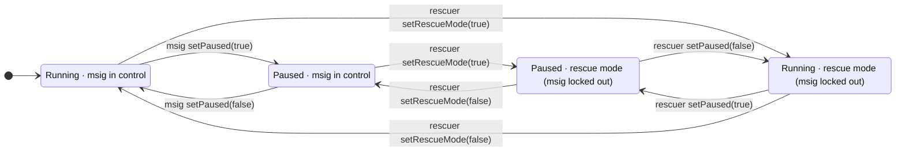

# FixedPriceAuction and Wishing Well: a simplified model

This proposal simplifies [TempleDAO/temple#1305](https://github.com/TempleDAO/temple/pull/1305) (FixedPriceAuction, at `2127d590`) and [#1304](https://github.com/TempleDAO/temple/pull/1304) (WishingWell, at `4320b382`) to the smallest design that meets the requirements below.

These roles appear throughout:

| Role | Who it is |
|---|---|
| **msig** | The team multisig, the `executor` in code. |
| **blocker** | An account the msig appoints with `ComplianceCheck.setBlocker`. It can edit the compliance list. |
| **rescuer** | A guardian held by a separate, well-secured multisig. It has narrow powers, and the msig can't change it. |
| **funder**, **proceedsRecipient** | Treasury addresses. |

A FixedPriceAuction sells `fillToken` for deposited `bidToken` at a fixed price. Depositors bid during a deposit window, and the Treasury funds during a fulfillment window. If funding falls short, every depositor fills the same fraction.

The requirements are:

- if an account is blocked, its funds stay in the auction, and nothing moves them to escrow or releases them after a delay;
- a compliance list that the msig or a blocker can edit, with a pointer the msig can update;
- a rescuer-only, one-way switch to disable compliance, as a check on a rogue msig;
- a way to stop everything in an incident, which the msig controls and the rescuer can take over.

The Wishing Well lets an account record that it would swap one token for another. The team sums these wishes off-chain to decide which auctions to run.

Numbered decisions refer to the list at the end.

## The design in brief

`ComplianceCheck` blocks addresses. Each auction has its own pause that stops every function that moves tokens. Blocked or paused means the call reverts and the money stays put. The rescuer can disable compliance for good. It can also switch on rescue mode, which locks the msig out of the auction and lets the rescuer pause and unpause until it switches rescue mode off.

## Who can call what

| Role | In code | Can do |
|---|---|---|
| **msig** (factory) | `executor`; locked out while the factory's rescue mode is on | `createAuction`, `proposeImplementation`, `proposeNewExecutor` |
| **msig** (auction) | `executor`; locked out while rescue mode is on | `cancel`, `endFulfillment`, `setPaused`, `setComplianceCheck`, `recoverToken`, `exclude`, `reinstate`, `proposeNewExecutor`, and the proposed `setFunder`/`setProceedsRecipient` (decision 6) |
| **msig** (`ComplianceCheck`) | `executor` | `setBlocked`, `setBlocker`, `proposeNewExecutor` |
| **blocker** | `isBlocker` on the list, set by the msig with `setBlocker`. Trusted: the msig picks and removes blockers | `setBlocked`, and `exclude` and `reinstate` on every auction pointing at that list, outside rescue mode, while compliance is enabled |
| **rescuer** | `rescuer` (each auction takes the factory's current one) | factory: `acceptImplementation`, `setRescueMode`, and the two-step rescuer handover. Auction: `disableComplianceCheck` (one-way, any time), `setRescueMode`, `setPaused` and `cancel` while rescue mode is on, and the two-step rescuer handover. Nothing else. |
| **funder** | `funder` (fixed at deploy, see decision 6) | `fund`, `withdrawExcess` |
| **anyone** | — | `deposit`, `withdrawDeposit`, `claim`, `withdrawExcluded`, `claimTreasury` (pays the funder and proceeds addresses) |

## Contracts

### 1. `ComplianceCheck` (new, one shared instance)

```solidity
contract ComplianceCheck is IComplianceCheck, ExecutorAccess {
    mapping(address account => bool blocked) public isBlocked;
    mapping(address account => bool) public isBlocker;

    event BlockedSet(address indexed account, bool blocked);
    event BlockerSet(address indexed account, bool value);

    function setBlocker(address account, bool value) external { /* msig only */ }
    function setBlocked(address[] calldata accounts, bool value) external { /* msig or a blocker */ }
}
```

`ComplianceCheck` has an allow-list instead of the per-function grants in `TempleElevatedAccess`: the `executor` and any blocker can edit the list. Only the `executor` can appoint blockers or propose a new executor. There's no rescuer and no rescue mode.

If you later want a Chainalysis sanctions feed, deploy a new `ComplianceCheck` that wraps it and have the msig repoint each auction.

Put `IComplianceCheck` in its own file, imported by `ComplianceCheck`, the auction and the factory. #1305 declares `IComplianceCheck` and `IAuctionTokenRegistry` in `IFixedPriceAuction.sol`, and #1304 declares them again in `WishingWell.sol`, so a file that imports both files whole fails to compile.

### 2. `FixedPriceAuction` (simplified)

```text
Clone args: bidToken, fillToken, price, depositStart, depositEnd, fulfillmentEnd,
            minDeposit, funder, proceedsRecipient, initial complianceCheck
            (fixed for the auction's life; see section 4)

State:      priceDenominator (set once in initialize)
            complianceCheck (msig-settable), complianceDisabled (one-way)
            paused
            outcome (None | Settled | Cancelled), settledAt, settlement snapshot (`filledDeposits`, `userFunding`, `userRefund` and `funderRefund`, fixed at settlement)
            deposits[account], claimed[account], treasuryClaimed
            totalDeposits (excluded balances aren't in it)
            excluded[account] (bid tokens taken out of the fill; never filled)
            bidOwed, fillOwed (liability counters; each falls by exactly what's paid;
                               bidOwed counts excluded balances until withdrawn;
                               before settlement, fillOwed is the funding held)
```

Bidders deposit `bidToken`, and the funder supplies `fillToken`. `price` is fill tokens per whole bid token, scaled by 1e18; `priceDenominator` is derived from the tokens' decimals at deploy. Phases: Scheduled before `depositStart`, Deposit until `depositEnd`, Fulfillment until `fulfillmentEnd`, then Settled (or Settled early when the msig calls `endFulfillment`). If `fillOwed` covers only part of the deposits, every depositor fills the same fraction and gets the rest of their bid tokens back.

| Function | What it does | Caller | Phase | Blocked address | Paused |
|---|---|---|---|---|---|
| `deposit(amount)` | Pulls bid tokens from the caller and adds them to their deposit. Enforces `minDeposit`. | anyone | Deposit | revert | revert |
| `withdrawDeposit(amount)` | Returns part or all of the caller's deposit. What's left must be zero or at least `minDeposit`. | depositor | Deposit | revert | revert |
| `fund(amount)` | Pulls fill tokens from the funder into the auction. | funder | Fulfillment | — | revert |
| `withdrawExcess(amount)` | Returns fill tokens above what's needed to fill every deposit. | funder | Fulfillment | — | revert |
| `endFulfillment()` | Settles the auction now, with the funding held so far. | msig | Fulfillment | — | allowed |
| `cancel()` | Aborts the auction: no trade, all deposits and funding become refundable. | msig; the rescuer instead while rescue mode is on | unsettled, before `fulfillmentEnd` | — | allowed |
| `exclude(account)` | Moves a blocked bidder's whole deposit out of the fill into `excluded[account]`, lowering `totalDeposits`. No tokens move. | msig, or a blocker on the current list; both locked out in rescue mode | Deposit or Fulfillment | the target must be blocked; reverts once compliance is disabled | allowed |
| `reinstate(account)` | Puts a cleared account's excluded balance back into its deposit. Re-runs the deposit overflow guard. | as `exclude`; a blocker stops counting once compliance is disabled | Deposit | the target must not be blocked | allowed |
| `withdrawExcluded()` | Returns the caller's whole excluded balance. | excluded bidder | any | revert; withdraw later | revert |
| `claim()` | Settles if needed, then pays the caller their pro-rata fill tokens and the unfilled refund. On a cancelled auction it refunds the whole deposit. | depositor | Settled or Cancelled | revert; claim later | revert |
| `claimTreasury()` | Settles if needed, then pays `filledDeposits` to `proceedsRecipient` and `funderRefund` to `funder` from the settlement snapshot. | anyone | Settled or Cancelled | — | revert |
| `recoverToken(token, to, amount)` | Sends out tokens that aren't owed to anyone, such as tokens sent by mistake. | msig | any | — | revert |
| `setPaused(bool)` | Pauses or unpauses the auction. | msig; the rescuer instead while rescue mode is on | any | — | allowed |
| `setRescueMode(bool)` | Switches rescue mode on or off. While it's on, the msig can't call any msig function on that auction and the rescuer controls the pause. | rescuer | any | — | allowed |
| `proposeNewExecutor`/`acceptExecutor`, `proposeNewRescuer`/`acceptRescuer` | Two-step role handovers (see the rescue-mode callout). `acceptExecutor` waits `EXECUTOR_HANDOVER_DELAY` (1 day) after the proposal. | propose: msig (locked out in rescue mode) or rescuer; accept: the proposed address | any | — | allowed |
| `setComplianceCheck(addr)` | Points the auction at a `ComplianceCheck` contract, for example to replace a broken or rogue one. Reverts on `address(0)`. Only `disableComplianceCheck` turns screening off. | msig | any, until disabled | — | allowed |
| `disableComplianceCheck()` | Switches screening off for good. Afterwards `setComplianceCheck` reverts. | rescuer | any | — | allowed |
| `setFunder(addr)`, `setProceedsRecipient(addr)` | Proposed (decision 6). Replace a compromised Treasury address. | msig | any | — | allowed |
| views: `phase`, `getConfig`, `getTiming`, `previewSettlement`, `claimable`, `treasuryClaimable`, `withdrawableExcess` | Read the current phase, the deployment terms, the schedule, the settlement maths, what each party can claim, and how much funding the funder can withdraw now. | anyone | any | — | allowed |

`fund`, `withdrawExcess` and `claimTreasury` aren't screened, because they only pay Treasury addresses.

```solidity
function _isBlocked(address a) private view returns (bool) {
    return !complianceDisabled && IComplianceCheck(complianceCheck).isBlocked(a);
}
```

The pause stops every function that moves tokens. `endFulfillment` moves no tokens, so it works while paused, as it does today. The pause has no timer and no single-use limit. The msig toggles the pause. The rescuer can take over the pause (see [Pause and rescue mode](#pause-and-rescue-mode)). The clock keeps running while paused, so a long pause can let the deposit or fulfillment window lapse.

> [!NOTE]
> **A pause during the fulfillment window decides the funding.** `fund` and `withdrawExcess` revert while paused, and the clock doesn't stop. If the auction is still paused when `fulfillmentEnd` passes, it settles with whatever funding it held when the pause began: a partial fill, or no fill and a full refund for every depositor. Unpause before `fulfillmentEnd` if the funder still needs to top up. A pause held across `depositEnd` likewise takes away depositors' right to withdraw.

> [!IMPORTANT]
> **Rescue mode needs its own small access-control base.** While rescue mode is on, the rescuer controls the pause and can `cancel`, and gets none of the msig's other powers: no `endFulfillment`, `setComplianceCheck`, `recoverToken`, factory or address setters.
>
> ```solidity
> // ExecutorAccess: the executor passes; RescuableAccess narrows it.
> function _isElevatedAccess(address caller) internal view override returns (bool) {
>     return !inRescueMode && super._isElevatedAccess(caller);
> }
>
> function setPaused(bool value) external {
>     if (inRescueMode ? msg.sender != rescuer : msg.sender != executor) revert InvalidAccess();
>     emit PausedSet(value);
>     paused = value;
> }
> ```
>
> Don't inherit `TempleElevatedAccess` as it is. In its rescue mode the rescuer passes every `onlyElevatedAccess` check. In #1305 that means the three cancel functions, `endDeposit`, `endFulfillment`, `setDepositsPaused`, `setMaxTotalDeposits`, `recoverToken`, `excludeBidder`, `proposeRelease`/`executeRelease`, `disableComplianceCheck`, `setExplicitAccess` and `proposeNewExecutor`. Here it would also cover `setComplianceCheck`.
>
> **Accepted risk.** A breached rescuer could lock the msig out of an auction. It could keep the auction paused, even past settlement, unpause one the msig paused during an incident, or cancel a genuine auction, which refunds everyone and loses the sale. Claims only ever pay the depositor, so funds can't be redirected. The team accepts this risk because the rescuer is a separate, well-secured multisig.
>
> Rescue mode is per auction. Each auction keeps the two-step handovers from `TempleElevatedAccess`, with three changes. The rescuer can't propose a new executor, and switching rescue mode on cancels any pending executor proposal, so a hijacked msig can't leave one to be accepted once rescue mode lifts. On the factory it also cancels a pending implementation proposal. Rescue mode is per contract: switching it on at the factory doesn't touch the auctions' proposals. A proposed executor can accept only `EXECUTOR_HANDOVER_DELAY` (1 day) after the proposal, so a hijacked msig can't propose and accept in one transaction before the rescuer reacts. `proposeNewRescuer` is rescuer-only, and `acceptRescuer` is callable only by the proposed rescuer, so only the rescuer picks its successor. Rotating the rescuer across the factory is decision 14. `ComplianceCheck` has the same delay but no rescuer and no rescue mode. On `ComplianceCheck` the msig can overwrite a proposal within the day (threat analysis T-2). The rescuer's answer to a rogue list is `disableComplianceCheck` on each auction.

#### Pause and rescue mode



| State | Bidders (deposit, withdraw, claim) | msig functions | Who controls the pause |
|---|---|---|---|
| Running · msig | work, unless the account is blocked | work | msig |
| Paused · msig | revert; funds stay put | work, except `recoverToken`; `cancel` only before `fulfillmentEnd` | msig |
| Running · rescue mode | work, unless the account is blocked | locked out | rescuer |
| Paused · rescue mode | revert; funds stay put | locked out | rescuer |

`disableComplianceCheck` sits outside these states. The rescuer can call it in any state; it's one-way, and afterwards nobody is blocked.

In rescue mode the rescuer can `cancel`, under the same rule as the msig: unsettled and before `fulfillmentEnd`. Cancelling only ever refunds, so it can't redirect funds, and it gives the rescuer a way to end an incident without the msig. The rescuer can't `endFulfillment`, because settling a rogue auction with the attacker's junk funding would pay the deposits to the attacker. After `fulfillmentEnd` nobody can abort (decision 10).

#### Settlement, recovery and events

Required funding rounds up. `userFunding`, and each bidder's share of it and of `userRefund`, round down. `filledDeposits` is the rounded-up cost of `userFunding`, so the bid tokens worth less than one fill-token wei go back as `userRefund`, even at full funding. That holds for the aggregate fill; each bidder's share rounds down separately, so a bidder can lose dust. The first `claim`, `claimTreasury` or `endFulfillment` call settles the auction and fixes the `Settlement` snapshot (`filledDeposits`, `userFunding`, `userRefund` and `funderRefund`). If all the deposits together would buy less than one fill-token wei, nothing fills: `filledDeposits` is 0 and every depositor gets a full refund, even at full funding. `claimTreasury` pays `filledDeposits` to `proceedsRecipient` and `funderRefund` to `funder` from that snapshot, because `fillOwed` falls as users claim. `claimTreasury` is permissionless, so anyone can trigger settlement. `AuctionSettled` carries `settledAt` (`fulfillmentEnd`, or `block.timestamp` when settled early).

`recoverToken` can only send the balance above the two liability counters, `bidOwed` and `fillOwed`. Each falls by exactly what's paid, so it can never touch a blocked account's unclaimed share. `bidOwed` keeps counting an excluded balance until `withdrawExcluded` pays it, so excluded tokens can't be recovered either.

#### Excluding flagged bidders

"Flagged" means the auction's current compliance list blocks the account, with compliance enabled. A flagged bidder's deposit stays in the fill unless the msig or a blocker calls `exclude`. Exclusion is a balance, `excluded[account]`, not a sticky flag: settlement, claims and `withdrawableExcess` use `totalDeposits`, which no longer counts it, so they need no exclusion logic. Exclusion zeroes deposits. An account cleared during Deposit can deposit again; unless the msig or a blocker calls reinstate, only that new deposit is filled.

| Flagged during | At the flag | Cleared in the same phase | Cleared later |
|---|---|---|---|
| Scheduled | Nothing to exclude; can't deposit while flagged | Deposits normally | Same |
| Deposit | Excluded: the deposit leaves the fill and is frozen; the treasury neither gets nor pays for it | back in as a full participant only if the msig or a blocker calls `reinstate` | `withdrawExcluded` only, never a fill |
| Fulfillment | Excluded, same treatment; funding already sent for it becomes withdrawable excess | `withdrawExcluded` only | `withdrawExcluded` only |
| Settled | Not excluded: the fill stands; fill tokens and unfilled refund frozen; the filled bid tokens go to the treasury | Claims normally | Claims whenever cleared |
| Cancelled | Its refund, or its excluded balance, stays frozen | claim for a refund, withdrawExcluded for an excluded balance | Same |
| Deposit or Fulfillment, `exclude` not called | Still in the fill, filled at settlement, payout frozen | Ordinary bidder | Claims when cleared |

**Legal (confirmed 2026-10-23):** once Fulfillment ends and the auction settles, the filled bid tokens (TEMPLE) are the treasury's proceeds, even if the bidder is blocked afterwards. The bidder's unpaid fill tokens (USDS) stay frozen until the block is removed: a freeze, not a confiscation, and fill tokens already claimed can't be frozen. Bought-back TEMPLE is unbacked, and its only use is being burnt. See decision 16 for the one case legal hasn't covered.

The rescuer's answer to a rogue list is `disableComplianceCheck`: afterwards nobody is flagged, so nothing more can be excluded and every excluded balance becomes withdrawable once the auction is unpaused.

**Events:** `Deposited`, `DepositWithdrawn`, `BidderExcluded`, `BidderReinstated`, `ExcludedWithdrawn`, `Funded`, `ExcessWithdrawn`, `AuctionSettled(settledAt, …)`, `AuctionCancelled`, `UserClaimed`, `TreasuryClaimed`, `PausedSet(bool)`, `RescueModeSet`, `ComplianceCheckSet`, `ComplianceCheckDisabled`, and `FunderSet`/`ProceedsRecipientSet` if decision 6 says yes. `initialize` emits `ComplianceCheckSet` for the initial pointer.

### 3. `WishingWell`: record-only, keyed by (account, from, to)

A wish says an account would give up to `amount` of `from` to get `to`, until `expiresAt`.

```solidity
contract WishingWell {
    struct Wish { uint192 amount; uint64 expiresAt; }

    mapping(address account => mapping(address from => mapping(address to => Wish))) public wishOf;

    event WishSet(address indexed account, address indexed from, address indexed to, uint256 amount, uint64 expiresAt);

    function wish(address from, address to, uint192 amount, uint64 expiresAt) external {
        wishOf[msg.sender][from][to] = Wish(amount, expiresAt); // amount 0 revokes
        emit WishSet(msg.sender, from, to, amount, expiresAt);
    }
}
```

The Well holds no money and makes no compliance call. The indexer screens wishes against a `ComplianceCheck` (decision 12), so the Well needs no rescuer switch, pointer or pause.

### 4. `AuctionFactory`: one factory, swappable auction code

Anyone can deploy a `FixedPriceAuction`, or a contract that emits the same events. Without an on-chain list of genuine auctions, an indexer or front-end that finds auctions by their events can be fed fake ones. A fake auction can emit `AuctionSettled`, and the indexer would subtract those fills from real wishes. A factory closes this gap. It records every auction it deploys.

The aim is one factory for good, so indexers and front-ends watch one address. The factory deploys each auction as a Solady `LibClone` clone of its current `implementation`, with the auction's config appended as immutable args, the same pattern as Origami's `OpalAdapterFactory`. New auction code ships as a new implementation, swapped in with two keys: the msig proposes it and the rescuer accepts it by address, so a proposal changed after the rescuer reviewed it can't be accepted by mistake. A hijacked msig alone can't put new code behind `isAuction`, and a breached rescuer alone can't propose any.

```solidity
contract AuctionFactory is IAuctionFactory, RescuableAccess {
    address public implementation;
    address public proposedImplementation;
    mapping(address auction => bool genuine) public isAuction;

    event AuctionCreated(address indexed auction, address indexed implementation, bytes config);
    event ImplementationProposed(address indexed implementation);
    event ImplementationSet(address indexed implementation);

    function createAuction(bytes calldata config) external onlyElevatedAccess returns (address auction) {
        auction = LibClone.clone(implementation, config);
        isAuction[auction] = true;
        emit AuctionCreated(auction, implementation, config);
        IAuction(auction).initialize(executor, rescuer); // validates config; the implementation can't be initialized
    }

    function proposeImplementation(address newImplementation) external onlyElevatedAccess {}
    function acceptImplementation(address newImplementation) external onlyRescuer {} // must match the proposal
}
```

- **The config is opaque bytes,** so a later implementation can take a different config without a new factory. For this version it's `abi.encode(AuctionConfig)`, and indexers decode it by `implementation`.
- **The auction reads its config from the clone's code,** not storage: one `_config()` decodes the whole `AuctionConfig` with `abi.decode(LibClone.argsOnClone(address(this)), (AuctionConfig))`, and `getConfig()` returns it. There are no per-field getters (`bidToken()` and so on) and no byte offsets to get wrong. Reading the config this way, plus the clone's forwarding call, adds about 2.1k gas to each call. Only what changes lives in storage: the roles, the pause, the compliance pointer, the counters and the settlement snapshot. `priceDenominator` is worked out once in `initialize` and stored, because it reads token decimals.
- **`initialize` runs in the same call as the clone,** so nobody can get in first. The implementation marks itself initialized in its constructor, so it can never be initialized directly.
- **The factory gets rescue mode,** using the same base as the auction. With one factory for good, redeploying it is no longer the answer to a hijacked msig. Rescue mode locks the msig out of `createAuction` and `proposeImplementation` until the rescuer switches it off. The rescuer hands over its own role in two steps, as in the auction, and new auctions take the factory's current rescuer. Rotating it leaves each live auction with the rescuer it was created with.

```solidity
struct AuctionConfig { // abi-encoded into each clone
    address bidToken; address fillToken; uint256 price;
    uint64 depositStart; uint64 depositEnd; uint64 fulfillmentEnd;
    uint256 minDeposit; address funder; address proceedsRecipient; address complianceCheck;
}
```

The factory deploys each auction with its own `executor` (the msig, which is the only caller `createAuction` allows) as `executor` and the factory's current `rescuer` as the rescuer, and no caller can pass a different one. Otherwise a rogue msig could deploy auctions with a puppet rescuer. Config validation lives in the auction's `initialize`: `depositStart` in the future, `depositStart < depositEnd < fulfillmentEnd`, `fulfillmentEnd <= type(uint40).max`, `bidToken != fillToken`, `price != 0`, non-zero `funder`, `proceedsRecipient` and `complianceCheck`, token decimals from 6 to 18.

TGLD (TempleGold) moves only when the sender or the receiver is authorised on TempleGold, so authorise every TGLD auction before `depositStart`. Otherwise an authorised depositor can move TGLD into the auction, and that TGLD can then leave only to authorised receivers (not unauthorised bidders or the proceeds recipient) until the auction is authorised. `TempleGold.authorizeContract` is owner-only and the msig owns TempleGold, so the msig authorises each TGLD auction in a transaction after `createAuction`, using the address from `AuctionCreated` and before `depositStart`. Authorising in the same batch would mean predicting the clone's address from the factory's nonce, which goes wrong if queued creations run out of order. Never de-authorise an auction until its claims are done. The factory can't do it without being given control of TempleGold's whole authorisation list.

TGLD auctions are meant to burn the TGLD they collect. No burner contract exists yet. Building one, and requiring TGLD auctions to use it as `proceedsRecipient`, is decision 11. If `setProceedsRecipient` exists (decision 6), it must keep the burner on TGLD auctions.

- Indexers subscribe to one event on one address, `AuctionCreated`. Its `config` gives each auction's market (`bidToken` → `fillToken`).
- Front-ends reject look-alike contracts with `isAuction`.


### Upgrading the auction

The msig proposes a new implementation and the rescuer accepts it. Auctions created after that use the new code; existing auctions keep theirs. Keep `IFixedPriceAuction` unchanged across versions, or only add to it, so the indexer reads every version the same way. A version that changes the config layout changes how `config` decodes, which indexers key on `implementation`.

A new factory is only needed if the factory itself changes, or if the msig's Safe is lost for good: rescue mode stops a hijacked msig, but only the msig can hand over the executor role.

## What the indexer does

With a record-only Well, all judgement about demand happens off-chain. The indexer only counts auction events from addresses where `isAuction` is true. It reads:

| Need | Event |
|---|---|
| The wish | `WishSet(account, from, to, amount, expiresAt)` |
| Which auctions are genuine, and their market | `AuctionCreated` from the factory |
| Who bid, and how much | `Deposited`, `DepositWithdrawn` |
| How much filled, and when | `AuctionSettled`, which carries `settledAt` |
| Cancelled auctions (no fills, deposits refundable) | `AuctionCancelled` |
| Each auction's screening | `ComplianceCheckSet`, `ComplianceCheckDisabled` |
| Balances | ERC-20 `Transfer`, or `balanceOf` at a pinned block |
| Who is blocked | `BlockedSet` from `ComplianceCheck` |

Rules:
- A wish matches an auction when `bidToken == from` and `fillToken == to`.
- **A wish counts the smaller of two numbers.** One is its amount minus fills from matching auctions settled after the wish. The other is the account's balance of `from`.
- An account's fill is `deposit − floor(deposit × userRefund / totalDeposits)` in `from` units. `userRefund` and `totalDeposits` come from `AuctionSettled`. Before it appears, take `userRefund` from `previewSettlement` and `totalDeposits` from `totalDeposits()`.
- **One balance cap per `from` asset.** The sum of an account's counted wishes that give the same asset can't exceed what it holds of it.
- **Buckets** are indexer config that group pairs into markets, for example USDS and USDC as "stables". The team reads demand per bucket. Summing across a bucket normalises decimals (USDS has 18, USDC has 6).
- Expired wishes and wishes with amount 0 count zero.
- **Blocked accounts count zero.**
- **Every batch of reads uses one pinned block,** so one balance can't be counted twice by moving it between reads.

Open choices for the indexer (decision 9):
- Does a new wish reset the fills already subtracted? Recommended: yes, because the latest wish replaces the old one.
- Do tokens sitting in a live auction, or an unclaimed refund, count as held? Recommended: yes, otherwise demand drops to zero the moment a wisher bids. Count `deposits(account)` while the auction is live and `claimable(account).bidTokenRefund` once it's final: `deposits()` doesn't drop when an account claims, so using it after a claim double-counts the refund.

## What happens when something goes wrong

| Incident | Response |
|---|---|
| One address must be blocked | msig or a blocker blocks it. Its deposit, withdrawal and claim revert, and its funds stay put. Before settlement, either can also `exclude` it, so its deposit is refunded once it's cleared and never filled. |
| Accounting bug, or a rush of depositors to withdraw | msig pauses the affected auction: every function that moves tokens stops. Investigate, then unpause, or `cancel` before `fulfillmentEnd`. |
| Compromised `funder` or `proceedsRecipient` | If decision 6 adds the setters: msig pauses, replaces the address with `setFunder` or `setProceedsRecipient`, then unpauses. Without them, for `proceedsRecipient`: pause, then cancel before `fulfillmentEnd`, so no proceeds accrue. For `funder`, don't cancel, because cancelling returns all funding to the compromised address. Let the auction settle, so fills go to depositors and only the unused funding reaches the funder. |
| Rogue blocker | msig removes it with `setBlocker` and fixes the list, or repoints the auctions to a new `ComplianceCheck`. |
| Rogue msig pauses for good, or blocks everyone | rescuer switches rescue mode on, which locks the msig out. It unpauses and/or calls `disableComplianceCheck`, and switches rescue mode off once the msig can be trusted again. If the Safe can't be recovered, rescue mode stays on until the auction settles by the clock. |
| Hijacked msig deploys rogue auctions through the factory | (1) The rescuer switches rescue mode on in the factory, which stops new auctions and code proposals, and in every live auction, which locks the hijacked msig out. It calls `disableComplianceCheck` on any auction whose list the msig has abused. (2) For each rogue auction already created, the rescuer switches rescue mode on and cancels it as soon as `AuctionCreated` appears, ideally before `depositStart` and at the latest before `depositEnd`: from `depositEnd` the hijacked msig can fund with junk and settle in one block, and a settled auction can't be cancelled. Anyone who already deposited gets a full refund at once, whatever the auction's windows. (3) If the Safe's signers recover it, the rescuer switches rescue mode off. If the Safe is lost for good, the team deploys a new Safe, `ComplianceCheck` and factory, and the indexer and front-ends add the new factory and stop counting new auctions from the old one. Genuine auctions finish under rescue mode, because claims settle them by the clock. |
| Incident while the msig can't act | rescuer switches rescue mode on and pauses. To abort, it cancels before `fulfillmentEnd`, which refunds everyone. |

## Deploy checks

- **Price units.** The price is fill tokens per whole bid token, scaled by 1e18, and it's fixed at deploy. Print a sample conversion (for example "100 TGLD buys 4.66 USDS") before signing. Entering `4` instead of `4e18` makes the fill 1e18 times too small. 100 TGLD would buy 400 wei of USDS.

## What this cuts from #1305

| Removed | Why it's safe |
|---|---|
| Frozen escrow and the release flow: `frozenBid`/`frozenFill`, `proposeRelease`/`executeRelease`/`vetoRelease`, the 7-day delay, `frozenFundsReceiver` | blocked now means it stays put and is claimable once unblocked |
| `excludeBidder`'s escrow | replaced by `exclude`, which only moves the deposit out of the fill into a balance the bidder withdraws once cleared (decision 2) |
| `emergencyPause`/`emergencyUnpause` with their 14-day timer and single-use flag | replaced by a plain pause over every function that moves tokens, toggled by the msig, or by the rescuer in rescue mode |
| `setDepositsPaused` | the auction pause, or `cancel` |
| `endDeposit` and `noticePeriod` | fixed schedule; `cancel` to abort |
| The deposit cap: `maxTotalDeposits`, `setMaxTotalDeposits` | funding is discretionary, so the Treasury fills what it chooses, and cap squatting (one large deposit fills the cap and shuts others out, then withdraws) goes away |
| `depositWithPermit` | permit only helps stables; approve then deposit works for every token |
| `finalize`, `_releaseDust`, `unclaimedBidders`, the claim budgets | claims settle lazily; a few wei of rounding dust stays put |
| Three cancel functions | merged into `cancel()` |
| Supported-token registry check (`IAuctionTokenRegistry`) and the notice and maximum-duration rules | the msig chooses the tokens and schedule in `createAuction`; the auction relies on standard ERC-20s with exact transfers (decision 13) |
| The `remainingFunding`, `fullFundingRequired` and `liabilities` views | folded into `previewSettlement` and `claimable` |
| `disableComplianceCheck` callable by the msig | now rescuer-only, so the rescuer can lift a rogue msig's blocks for good. The msig can still repoint to a permissive list, which the requirements allow, since the msig can update the pointer. |

About 35 external functions shrink to 22, counting views but not access-control-base functions or public getters (24 with the decision 6 setters). Of 20 events and 23 errors, roughly half remain. These threats go away with the code that caused them:
- frozen-release snapshot bugs
- dust-counter accounting
- a timed pause outlasting the windows
- cap squatting
- the escrow-accounting invariants

## What this cuts from #1304

The record-only Well drops signed wishes and nonces, the on-chain balance and compliance checks, the token registry check, the Sell/Buy direction, with Buy wishes priced in a separate payment asset, exclusions, thresholds and quorum durations, and the on-chain totals. The indexer applies all of these rules off-chain.

## What it keeps on purpose

- **Fixed price, pro-rata fill, partial funding, refunds and cancellation.** The auction exists to provide these.
- **`minDeposit`.** It stops dust deposits.
- **`recoverToken` above what's owed.** Stray tokens can be recovered. It tracks two simple liability counters, no budgets.

## Decisions for the team

1. Are these cuts acceptable? That covers the timed emergency pause, the deposit pause (`setDepositsPaused`), the cap, early close (`endDeposit`) and permit.
2. ~~**Legal:** can a blocked account's deposit be filled, with its fill waiting until it's unblocked?~~ **Resolved** by the exclusion rules in [Excluding flagged bidders](#excluding-flagged-bidders): before settlement, `exclude` takes a flagged deposit out of the fill and it's refund-only; after settlement the fill stands and the payout waits.
3. Should `withdrawDeposit` revert for blocked accounts? This proposal assumes yes, to match "funds stay where they are".
4. The pause is per auction, so stopping everything takes one transaction per live auction. Is that acceptable, given only a few auctions run at once?
5. Should a blocker also be able to pause? That needs `setPaused` to accept a blocker on the current list, as `exclude` does, locked out in rescue mode like the msig.
6. Should the msig be able to change `funder` and `proceedsRecipient`? Today both are fixed. If yes, TGLD auctions must keep the burner. Without the setters, a compromised funder can't be recovered from. A hijacked msig could point both addresses at itself before the rescuer reacts, and the rescuer can't change them back.
7. **Rescue mode (see the rescue-mode callout in [`FixedPriceAuction`](#2-fixedpriceauction-simplified)):** confirm the small access-control base, where rescue mode only locks the msig out and hands the rescuer the pause, and the accepted risk that a breached rescuer could lock the msig out of an auction.
8. **One factory with swappable code:** confirm the two-key swap (msig proposes, rescuer accepts) and rescue mode on the factory. The cost is a Solady dependency, clone-arg reads in the auction, and an `initialize` step. Every auction version also depends on one factory contract, so one bug in it reaches every auction.
9. **Indexer choices:** does a new wish reset subtracted fills, and do tokens in a live auction count as held?
10. Should `cancel` also be allowed after `fulfillmentEnd` while the auction is unsettled and paused? If added, should it stay msig-only?
11. Should we build a TGLD burner contract and require TGLD auctions to use it as `proceedsRecipient`?
12. Which `ComplianceCheck` does the indexer screen against? Does it stop screening when the rescuer disables compliance on the auctions? In this design, the rescuer's switch only reaches the auctions.
13. Should the factory keep the supported-token check (`IAuctionTokenRegistry`) at `createAuction`?
14. How does the rescuer rotate? Options: a handover on each auction plus a new factory, or a factory that reads the rescuer from a rescuer-owned slot instead of an immutable. When the msig rotates, do `ComplianceCheck` and the factory get a two-step executor handover, or do we redeploy them and repoint the auctions?
15. **Pending renames**, agreed, to apply on whichever branch is kept:
    - `endFulfillment()` → `settleEarly()`, because it only settles before `fulfillmentEnd`;
    - `previewSettlement()` → `settlement()`, because once the auction is final it's the actual settlement;
    - `Settlement.userFunding` → `userFill`, the fill tokens shared among bidders;
    - `Settlement.filledDeposits` → `filledBids`, the bid tokens that were filled;
    - `AuctionFactory` / `IAuctionFactory` → `FixedPriceAuctionFactory` / `IFixedPriceAuctionFactory`.

    The `AuctionSettled` event keeps its name. `bidToken` / `fillToken`, `claimTreasury` and the Fulfillment phase names stay as they are.
16. **Legal:** with partial funding, a bidder blocked after the fill also has an unfilled bid-token refund, and `claim` pays the fill and the refund together, so the refund is frozen too. Legal's answer covered the filled TEMPLE and the USDS; confirm that freezing the unfilled TEMPLE refund until the block is removed is acceptable.
